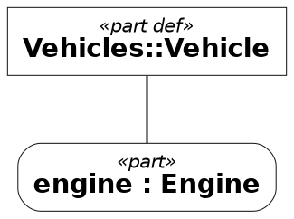

# View rendering forms — the view engine's writers

> **Labels.** This is an engineering record. "Track W" and its items (`W1`–`W4`) name entries of
> [the roadmap](roadmap.md), where each is stated in full; a reader who only wants the design can
> ignore them.

Status: **`text`, `markdown`, `csv`, `tsv`, `mermaid`, `dot`, `plantuml` and `d2` implemented** — `dot` is Track W's
`W1`, `plantuml` its `W2` and `d2` its `W4`, each wired into every surface `W3` names. This page records how a
view's rendering is separated from the forms it is written in, how Mermaid, Graphviz DOT,
PlantUML and D2 compare, and what the writers emit — the
[DiagramLayout](diagram-layout-annotations.md) geometry included.

## The rendering and its forms

A view renders into a `view.Rendering` (`internal/ir/view/view.go`): the kind (`tree`,
`interconnection`, `state`, `action`, `case`, `mixed`, `sequence`, `table`, `matrix`, and the
[GeneralView graphs](#generalview-graphs) `requirement`, `definition` and `package`), typed nodes
with an identifier, a
kind, a name, the declared type of a typed usage, an optional detail holding the notes (`initial`,
`already shown`, `own flow`) and their children, edges with a label and an `EdgeKind`
(connection, binding, transition, succession, flow, composition, association, include, anchor,
typing, specialization, reference, and the GeneralView graphs' containment, import, satisfy, verify,
derive, refine and allocate), a table's columns and rows, the origin of every node
and row, and notices for what the kind could not represent. The tree, interconnection, state,
action, case and mixed kinds are produced from the model — the behavior kinds from the lowered
`StateGraph` and `ActionGraph` the runtime executes — and nothing in the rendering is text of any
diagram language.

What a kind walks into nodes is model content. A view's own bookkeeping is left out of every
kind, by the one member walk the kinds share (`contentKind` in `tree.go`): a
[DiagramLayout](diagram-layout-annotations.md) annotation — a `Canvas`, `Layout` or `Route`,
whether a prefix `@Layout` or a `metadata Layout about …` member, wherever it is owned — and the
`render` members a view holds (`render asTreeDiagram;`, `render rendering r : AsTree;`). Both say
how a picture is drawn, not what the model is, so a tree over a package of migrated views draws
those views without the `metadata` and `render` nodes their annotations would add. Once a tree's
nodes are built, `treeEdges` (`tree_edges.go`) draws the relationships between them that the
general view's definition graph draws: a `specialization` from an element to each general it
specializes, subsets or redefines; the `typing` of each usage to its drawn definition; and the
feature membership of each part, item, port, attribute, occurrence, enumeration or `ref` usage
drawn under its owner, declared or inherited, as a `composition` (filled diamond at the owner) or a
`reference` (hollow diamond) from the owner to the usage's node, with the usage's multiplicity at
the usage's end — the glyphs of SysML v2 §8.2.3.6, the diamond read from the model's
`Feature::isComposite` (`semantics.Model.UsageIsComposite`: a `ref`, an attribute, a port outside a
port, an end, a directed or an enumeration usage is non-composite). The writers draw that edge in
place of the containment line they draw to every other child, so a usage hangs off its owner by its
membership glyph alone. The directed parameters of a calculation, action or constraint definition
or usage — `in`, `out`, `inout` and `return` — are no member nodes of a tree: `treeParameter`
(`tree_parameters.go`) pins each on its owner's node as a `Port` with `Parameter` set and the
direction `pinDirection` reads, where §8.2.3.17, §8.2.3.19 and §8.2.3.20 set a calc's, action's and
constraint's parameters (`param-l*`, `param-r*`, `param-b*`). A `return` declaring no name is the
`result` pin, named by the `Function::result` it redefines (§7.19.2); a usage typed by a definition
pins each parameter once, its own redefining ones as declared and the definition's others as
inherited (`^y`). The text form lists the pins under their node direction first (`in x : Integer`,
the type under `typings`), DOT and D2 draw them as pins, and Mermaid's flowchart and PlantUML's
class diagram, which have no pin on a tree node, list them in a `parameters` compartment
(`labeller.parameterLines`). The pins are the tree's model structure and stay whatever
`parameter-symbols` says, as its members do. A usage listed in a compartment row instead of drawn as a node (the
compartment foldings, or a positioned tree's unplaced members) folds its membership and typing into
one edge from its owner to each drawn definition, labelled with the usage's name and multiplicity
at the definition's end — the property association a block definition diagram draws. Both
ends of a relationship edge must be nodes of the same rendering — a usage the depth bound leaves
undrawn draws no edge — an element drawn twice draws from its first node, and no specialization or
typing joins a node to one nested in it. A usage's `Style` dresses its membership edge as it does
its node; its `Note` stays anchored to the node. A membership edge's origin is the usage it stands
for, so a `Route` about the usage routes it — the usage's node, which such a route places nowhere,
folds into a row unless a Layout places it — and `DrawnIn` reports the usage drawn as an edge; a
specialization's or typing's origin is the name its clause relates to, no member of its own, so it
carries no route and a client lays it out itself. The
`MigrationMetadata::SynthesizedName` and `MigrationMetadata::StandIn` markers a migration leaves
in a body are left out the same way: they record what the migration did, not what the model
holds. Every other metadata usage — a user's `metadata Approved about errorCBE { by = "review"; }`,
an annotation typed by any definition outside `DiagramLayout` and `MigrationMetadata` — is drawn
as before, and a rendering usage owned by anything but a view (a `rendering` under a package)
stays a node.

A **form** is a writer over that tree (`internal/ir/view/form.go`):

| Form | Writer | Kinds | Role |
| --- | --- | --- | --- |
| `text` | `text.go` | every kind | What a person reads at a terminal |
| `markdown` | `markdown.go` | `table`, `matrix` | The machine-readable form of a table or relationship matrix |
| `csv`, `tsv` | `delimited.go` | `table`, `matrix` | A table or relationship matrix as comma- or tab-separated values, for spreadsheets and scripts |
| `mermaid` | `mermaid.go` | `tree`, `interconnection`, `state`, `action`, `case`, `mixed`, `sequence`, `requirement`, `definition`, `package` | The default machine-readable form of the graph-shaped kinds |
| `dot` | `dot.go` | `tree`, `interconnection`, `state`, `action`, `case`, `mixed`, `requirement`, `definition`, `package` | Graphviz DOT, the alternative to Mermaid |
| `plantuml` | `plantuml.go` | `tree`, `interconnection`, `state`, `action`, `case`, `mixed`, `sequence`, `requirement`, `definition`, `package` | PlantUML in the Pilot visualizer's B&W style, for PlantUML toolchains |
| `d2` | `d2.go` | `tree`, `interconnection`, `state`, `action`, `sequence`, `requirement`, `definition`, `package` | [D2](https://d2lang.com) in the same look, for D2 toolchains; nested containers and D2's own sequence diagram |

`Kind.MachineForm` chooses the form a tool gets when none is asked for — `markdown` for a table or matrix,
`mermaid` for everything else — and `Kind.SupportsForm` decides whether a kind can be written in
a form at all. Asking for a form the kind is not written in is one typed `WrongFormError`, naming
the kind, the form asked and the form the kind uses, on the CLI (`-render-all` skips the view and
says so), in the REPL and in an LSP render request. A document `Diagram` block renders table and
matrix kinds as tables in every diagram form; other incompatible forms are refused at planning
time.
D2 does not write case, mixed, table or matrix renderings and refuses them with the typed
`WrongFormError`.

## Relationship matrices

`matrix` is a tabular rendering for a standard `GridView`. It is selected only when a positive,
resolved `@T` selector in the view's own or inherited filters, or in the filters of its own or
inherited exposes, names a relationship kind below. A selector nested under logical `not` does
not activate it. SysML metaclass selectors match by identity; the two metadata selectors match
their specializations as well. An explicit `render asElementTable;` remains an ordinary table,
and an unknown or unrelated selector leaves the view's existing table behavior unchanged.

| Selector | Relationship kinds |
| --- | --- |
| `SysML::SatisfyRequirementUsage` | `satisfy` |
| `SysML::VerificationCaseUsage`, `SysML::VerificationCaseDefinition` | `verify` |
| `SysML::AllocationUsage` | `allocate` |
| `SysML::ConnectionUsage` | `connect`, `allocate`, `derive` |
| `SysML::InterfaceUsage` | `connect` |
| `SysML::Dependency` | `dependency`, `refine` |
| `ModelingMetadata::Refinement` | `refine` |
| `RequirementDerivation::DerivationMetadata` | `derive` |

The matrix's rows are relationship sources and its columns are targets. It admits unnamed members
through the matrix-only `ExposedMembers` path, then walks named and unnamed owned members to the
tree depth limit, without descending into nested views. Ordinary tables and other renderings keep
their existing named-member exposure and do not gain unnamed rows. A source and target occupy
their first-seen
positions; repeated edges between a pair collapse into one cell, whose comma-separated keywords
are ordered `satisfy`, `verify`, `allocate`, `connect`, `derive`, `refine`, `dependency`. Labels
use the table's qualified element names, and each row retains its source origin.

An exposed top-level member whose subtree contributes no displayed edge is named in a notice, in
exposure order; the notice names the selected relationship kinds in the fixed cell-keyword order.
An empty matrix distinguishes a view that exposed nothing from one whose exposed members have no
relationships. On the CLI and in the REPL, `#matrix` renders all loaded content; in a workspace
render request such as LSP, it renders the current document's top-level declarations. The engine
and gRPC `RenderView` surfaces have no current-document context, so their pseudo-views require a
target such as `#matrix:<target>`, which renders one declared element directly. Pseudo-views do not
change exposure for ordinary tables or any other rendering kind. Like a table, a matrix is written
in `text`, `markdown`, `csv` and `tsv`. Mermaid, DOT, PlantUML and D2 have no table grammar, so
requesting one of those forms is a typed wrong-form error naming `matrix`.

## Standard views first

A model selects a rendering with a standard view wherever one exists: a view definition from
`StandardViewDefinitions` narrowed by its element filters. Names in the non-normative OpenSysML
libraries, such as `CaseView`, are optional shorter forms of a standard route, never the only
route. The extension libraries hold only what standard SysML cannot express: mixed diagrams,
results from runs, and layout.

| Rendering | Route | Standard or extension |
| --- | --- | --- |
| Use case diagram | `GeneralView` with a case-family filter (`filter @SysML::UseCaseUsage;`); `CaseView` or `render asCaseDiagram;` from `OpenSysMLRenderings` is the shorter form | standard |
| Requirement, definition and package graphs | `GeneralView` with a requirement, definition/usage or package filter ([GeneralView graphs](#generalview-graphs)) | standard |
| Relationship matrix | `GridView` with a positive, resolved relationship filter ([selector rules](#relationship-matrices)) | standard |
| Mixed diagram | `MixedView` or `render asMixedDiagram;` from `OpenSysMLRenderings` | extension |
| Run timeline and run sequence | `-render-run` on the CLI, `%render-run` in the REPL; no view declares them | CLI and REPL only |
| Verdicts overlay | `Diagram::overlay = "verdicts"` from `DocumentQueries` in a document; `-render-overlay verdicts`, `%render … verdicts` and the LSP `overlay` option elsewhere ([The verdicts overlay](#the-verdicts-overlay)) | extension |
| Layout | `Layout`, `Route` and `Canvas` annotations from [DiagramLayout](diagram-layout-annotations.md) | extension |

## GeneralView graphs

The OMG library documents `GeneralView`'s typical rendering as "a graph of nodes and edges" and
lists, per specialization, the elements its filters keep. A view whose nearest standard view
definition is `GeneralView` (`gv`) itself, and whose filters select one of those
specializations, is drawn as that graph instead of a containment tree
(`internal/ir/view/general.go`, `Renderer.generalSpecialization`). The filters read are the
view's own `filter` members, those of the view definitions it specializes, and the conditions of
its filtered `expose`s (`expose X::**[@SysML::Package];`). Each is compiled by the semantic filter
evaluator, not matched as text, and selects a specialization only in one shape: a metaclass
classification `@T` or `@@T`, or an `or` of them, where `T` resolves to a `SysML` or `KerML`
library metaclass and is matched through the metaclasses it specializes:

| The metaclass is or specializes | Selects | Kind |
| --- | --- | --- |
| `RequirementDefinition`, `RequirementUsage` (so `SatisfyRequirementUsage`, `ConcernUsage` too) | the requirement view | `requirement` |
| `Package` (so `LibraryPackage`) | the package view | `package` |
| `CaseDefinition`, `CaseUsage` (so `UseCaseDefinition`, `UseCaseUsage`, the analysis and verification cases too) | the [case diagram](#case-and-mixed-diagrams) | `case` |
| `Relationship` (`Specialization`, `FeatureTyping`, `Import`, `AllocationUsage`, …) | nothing of its own; it may stand beside one that selects | — |
| `Definition`, `Usage` | the definition and usage view | `definition` |

The rows are tried in that order for each metaclass, and when the view's filters select more than
one kind, `requirement` is drawn before `package`, `package` before `case` and `case` before
`definition`, so the library's requirement-view filter list (`RequirementUsage or Specialization
or AllocationUsage …`) draws a requirement graph, `@SysML::Definition or @SysML::UseCaseUsage`
draws a case diagram and `@SysML::RequirementUsage or @SysML::UseCaseUsage` a requirement graph. Anything else keeps the view a tree, byte for byte as before: no
filter, a filter naming only relationships, a conjunction, a negation, a user metadata
condition (`@Safety`), a feature test (`@Safety::isMandatory`), or any of them mixed into an `or`
with a recognized condition. A recognized filter admitting nothing is an empty graph of its kind,
which says so.

A GeneralView that selects `case` is the case diagram itself: `Renderer.KindOf` answers `case`
and the [case writer](#case-and-mixed-diagrams) draws the exposed set, so the view needs only the
standard library and every form writes, links included, what a `CaseView` exposing the same
elements writes, but for the provenance line, which names the GeneralView and its filter
(`view def GeneralView, filter @UseCaseUsage`) where a CaseView names `render asCaseDiagram`.
`CaseView` remains the shorter way to write the same view, with the OpenSysML library; a mixed
diagram has no GeneralView route and still needs `MixedView` or `render asMixedDiagram;`.
See `examples/general-views-demo/use-cases.sysml`.

What each of the other graphs draws, as nodes from the exposed set and edges between drawn nodes:

| Kind | Nodes | Edges (`EdgeKind`) |
| --- | --- | --- |
| `requirement` | requirement and concern definitions and usages, labelled with their short name as `id` and the first line of their documentation or text, and the drawn ends of the relationships below | `satisfy` (from the satisfying feature), `verify` (from each verification case whose objectives verify it: its own, and those it inherits and does not redefine or restate by name, as the runtime runs them), `derive` (a `#derivation` connection's `derivedRequirement` from its `originalRequirement`), `refine` (a `#refinement` dependency), `allocate`, `specialization`, `typing` |
| `definition` | definitions and usages | `specialization` (subclassification, subsetting — a same-named subsetting to the inherited feature, as `DirectSupertypes` reads it — redefinition), `typing` (a drawn usage to its definition), `composition` (a drawn owner to a composite usage drawn as a node, its multiplicity at the usage's end; or, for a usage of the owner's that is not drawn, the owner to the drawn definitions typing it, named by the usage) and `reference` (a usage the model derives as non-composite — `ref`, attribute, port outside a port, end, directed or enumeration usage — likewise) |
| `package` | packages | `containment` (an owned package) and `import` (a membership or namespace import, recursive or not, to the package it names, or to the package owning the member it names, labelled `::<member>`; one edge per import declaration, linked to it) |

A relationship end that does not resolve draws no edge and is listed as a notice, and a cycle (mutually recursive part
definitions, requirements deriving each other, packages importing each other) is drawn once per
edge: the graph is built from symbols, never by following edges. Node and edge order is the model's
declaration order, so a rendering is deterministic. The writers draw each relationship with the
glyph of its §8.2.3 production — `specialization` and `subsetting` a solid hollow triangle,
`typing` the same with two dots at its base, `redefinition` the same with a bar, `composition` a
filled and `reference` a hollow diamond at the owner (a Mermaid flowchart, which has no diamond
head, leads the edge's label with `◆` or `◇` instead), `containment` a circle-plus at the
namespace, an import a dashed open arrow labelled `«import»`, and each requirement relationship a
solid open arrow named by its keyword (`«satisfy»`, `«verify»`, `«allocate»`), as the
interconnection already does for its requirement and allocation edges; a `derive` or `refine` is
the dashed `binary-dependency`. The [notation table](#notation-table) lists every glyph per form. The Cameo style frames
the three kinds `req`, `bdd` and `pkg`.

### The verdicts overlay

A requirement graph takes an opt-in overlay, `verdicts`: each requirement drawn is labelled with
the verdict of every verification case verifying it (`verdict pass by Cases::light, fail by
Cases::heavy`) and filled by the worst of them — `error` over `fail` over `inconclusive` over
`pass` — in the Okabe-Ito colours `#009E73`, `#F0E442`, `#D55E00` and `#CC79A7`, in every form
and style, replacing the fill and line of a requirement the view styles and keeping the rest of its
style. The cases run through `runtime.RequirementVerdicts`, the REPL's and a document's over the
runtime context the model is executed by and a workspace's over a declared reader, which answers
each requirement by its declaring document and span rather than its qualified name, the
subcases a case performs left to their case. Without the overlay nothing runs and the rendering
is the structural one; asking for it on another kind is refused (`a definition rendering draws no
verdicts overlay`), and an unknown overlay is refused with the overlays there are.

## Node labels

Every graphical form draws a node's label the way the graphical notation heads a compartment:
the kind in guillemets above the element's name, both centred. A quoted name's escapes decode in the label — `\n`
a line break, `\t` a tab, `\'` a quote — the quotes themselves kept; `Node.Name`, the JSON and
the text form keep the spelling. `label.go` composes the lines once, and each writer
only joins them:

1. the kind in guillemets, `«part»`, `«state def»` — left out when the name line is already the
   kind;
2. the name, with ` : Type` after it for a typed usage (`pump : Pump`); a definition has just its
   name; an anonymous element heads with its kind instead, or with ` : Type` alone when typed.
   A name the model did not give is not shown and the node heads as an anonymous one: a name a
   [v1 migration](../reference/sysml-v1-migration.md) made up for an element its source left
   unnamed, which it marks with `MigrationMetadata::SynthesizedName`, and the language's own
   `start` and `done` of an action's flow (`Node.NameSynthesized`, `shown` in `label.go`);
3. the detail, when there is one.

An action node whose name is not shown — one written with no name, or with one a migration made
up — heads with what it does instead of with `action`
(`Node.Text`, composed by `actionText` in `behavior.go` from the lowered `ActionGraph`, so no
writer reads the declaration back): an accept's trigger by the name it ends in (`Go Now`), a
send's message type or expression, the one assignment its body makes (`i := i + 1`), and for a
node with a single output and nothing else — a UML value specification action migrated as
`action value3 { out result : Boolean = true; }` — the literal its result is bound to (`true`,
`"SH-0"`, `0`), or `: Type` when the result has a type and no value. A node whose type names what
it calls heads `: Type` as any typed anonymous usage does, so a migrated `call5 : 'Setup APS'`
reads `: 'Setup APS'`. The `own flow` detail marks a node whose nested flow is drawn inside it;
it is set only when that flow lowers to nodes of its own, so an action whose body is a single
statement or a bound value carries no `own flow` and no nested cluster. The node is the nested
flow's frame: its own pins are the ones the flow's bindings attach to, and the flow's nodes take
the IDs after it.

A state's compartment lines name its behaviours (`stateBehaviorLabel`, `behaviorText` in
`behavior.go`): `entry / prime`, `do / Initialize`, `exit / Settle`, each behaviour by its name,
else by the activity its type performs (`do action : Initialize` reads `Initialize`), else by
what its anonymous body does — the message it sends or the one assignment it makes — and the
keyword alone when none of that names it.

A usage drawn or listed under an owner that does not declare it — one the owner has through
typing, subclassification or subsetting — is marked inherited (`Node.Inherited`, set by the tree
and interconnection walks, the case walk's inherited actors and subjects, and the action pins a
node takes from its type; `Port.Inherited` for a pinned port), and every form writes the
notation's `^` before its name (SysML v2.1 §8.2.3.6, `usage-name-with-alias` and `el-prefix`):
`^mass` in a node head, a compartment row and the text form, `^aPort : APort` for a typed one, a
pin's `^aPort` label, and the end label of a folded membership edge. A redefinition the owner
declares is its own and reads bare (`attribute :>> mass` under `part d : APart` lists `mass`,
beside `^aPort`), as does every member of a definition under the definition itself. The
`usagePrefix` in `label.go` is the one place the glyph comes from. The data form and the JSON the
LSP, the engine and the gRPC `RenderView` answer carry the mark as a field beside the bare name
(`Inherited` on `NodeData` and `Port`, `inherited` on `RenderNode` and `RenderPort`) rather than
in `name`, because the canvas and the clients key on names — the canvas's `labelHead` and
`portName` add the `^` when they draw. The derived-feature prefix `/` of the same production is a
different fact (the `derived` keyword, which the compartment row keeps as a prefix word) and is not
drawn as a glyph.

The name and type a node carries (`Node.Name`, `Node.Type`, the JSON's `name` and `type`) stay
as the walk spells them — a root's name qualified, a nested member's simple, a type as the
declaration references it — and the text form prints them so. The graphical forms head a node
the way a diagram frame does (`labeller` in `label.go`): the roots' names lose the namespace
every named root shares — the longest run of leading qualifier names common to all of them, so
`Plant::Loop` alone heads `Loop`, `Systems::Radio` beside `Systems::Braking::Brake` heads
`Radio` beside `Braking::Brake`, and roots from unrelated packages keep their whole names — and
a type is named by the name each of its references ends in, its `~` kept (`~Ports::FuelPort` is
`~FuelPort`; `Pump, ~FuelPort` for a pair); a name the roots' namespace does not head, and a type
that does not read as references, are shown whole. A member drawn under a drawn owner — a child
node, or a nested exposed element whose owner is a node of the same rendering — is headed by its
name below the nearest such owner, as a compartment or a nested box in a diagram frame shows it:
`'K-Mirror Offset'::'interpolation Error' : 'Interpolation Error'` under the `'K-Mirror Offset'`
node heads `'interpolation Error' : 'Interpolation Error'`, and a name with a single segment is
shown whole. Only the graphical heads change: `Node.Name`, the JSON and the text form keep the
qualified name. The DOT writer sizes a box from the same label it emits, so a box a Layout does
not size holds what it is headed with; a box a Layout sizes has its label fitted to it
([Geometry](#geometry)).

Safe flowchart labels use Markdown newlines; unsafe flowchart labels, leaf state labels, remaining
composite-state title lines and sequence participants use `<br>` for line breaks. The pinned
`mermaid-cli` breaks at `<br>` whether `htmlLabels` is on (the text becomes HTML, `<br>` a line
break) or off (the label is split into `<tspan>` rows); no `<br>` survives as text in the drawing.
The tree, interconnection and action kinds draw the same flowchart labels. The first line of a
subgraph or composite-state title puts the keyword and name together (`*«part def»* **Toolchain**`),
since Mermaid reserves one line for it. Only a flowchart subgraph title that still spans several
lines — a name with an escaped line break, or notes — emits `flowchart.subGraphTitleMargin.bottom`
in the frontmatter, at 24px per extra line. The flowchart theme CSS that centres multi-line titles
remains (`writeFlowchartFrontmatter`). Mermaid applies that margin after layout to every cluster
alike, so a nested cluster can still crowd its parent's title and stacked sibling clusters can
touch in such a chart; the model's content is preserved and the diagram carries no notice. Every
`subgraph` opens on a `direction` statement restating the flowchart's own (`TD`, `LR` for an
interconnection, or the one asked for), since Mermaid lays out a subgraph that states none without
regard to the flowchart's; a tree draws containment as edges, not subgraphs, so it states none.
Flowchart labels use Markdown when every line is safe, with the italic keyword first, then bold
head lines and plain details, separated by real newlines; unsafe labels fall back to the escaped
`<br>` form. DOT writes an
HTML-like label, `label=<<font point-size="10">«part»</font><br/><b>pump : Pump</b>>`, the keyword
line at 10pt over the name in bold at the 14pt Graphviz draws the rest in; `&`, `<`, `>` and `"` in a name become entities so no name
reads as markup. A cluster's label is the same string. The text form keeps the notation's
declaration order, `part pump : Pump`, with a detail parenthesised after it. The declared type is
a field of the node (`Node.Type`, `type` in the JSON), never parsed back out of the detail.

## Edge labels

An edge is labelled by its own text when it has any, and by its name only when it has none
(`edgeLabel` in `behavior.go`): a transition's label is its trigger, guard and effect, `accept Sig
[g] / act`; a succession's its guard and probability, `[g] p = 0.5`; a flow's the pins or the
payload it carries, `out to in`, `of Water`; and a connection's the name, else the declared type,
else the keyword. A flow between named pins also records the pins as its ends (`Edge.FromPort`,
`Edge.ToPort`, the IDs of the nodes' `Ports`), as does a parameter binding between two pins
(`bread = b`), so a writer that draws the pins on the action's
border attaches the edge to them and leaves the `out to in` text off; a writer that does not
keeps the text. An interconnection's connector at a port records the port the same way and keeps
its label in every form, the port naming only where it attaches. A named edge with none of that — a completion transition, a plain succession, a
binding — is labelled by its name, `'off then on'`. The rule holds for every kind and every name,
whether the model's author gave it or the [v1 migration](../reference/sysml-v1-migration.md#edges-a-diagram-shows)
spelled it from the ends: a triggered transition named `idle_to_moving` reads `accept Signal
[temperature > 0]`, as the graphical notation draws it, since the name adds nothing a reader
looks for and a migrated name would only repeat the ends. A name the migration made up because
the source had none (`MigrationMetadata::SynthesizedName`) never becomes a label: an edge with no
text of its own and such a name is drawn unlabelled, as its source drew it. The rule is one place,
so the text, Mermaid, DOT and PlantUML forms label an edge alike.

An association end's name is not the edge's text but the name of one end of it: a composite
part's name and multiplicity on the composition from its owner to its type, `wheels[4]`, and a
`ref`'s on the reference edge, belong at the type's end, where the graphical notation and the
v1 tools draw an end name. The edge records them as `Edge.ToLabel` (`Edge.FromLabel` for the
end at the owner; neither is set today, the graphs name only the type's end), apart from
`Edge.Label`, and each writer sets them at the end where its grammar has such a place: DOT as
`headlabel`/`taillabel` — Graphviz sets them by the head and tail of a laid-out edge, and a
routed edge places them itself ([Geometry](#geometry)) — PlantUML in quotes before the end's
alias (`n0 *-- "wheels[4]" n16`), D2 as the arrowhead's label (`target-arrowhead: { label:
"wheels[4]" }`). Mermaid's flowchart and the text form have no place at an end, so they fold the
names into the edge's text about its own (`Edge.text`), `◆ wheels[4]`, as they read before; the
render JSON of the LSP does the same (`EdgeData.Text`), since it carries no label positions.
A connection's own name stays the edge's text, mid-edge. A `connection def` drawn as an edge
through the same path would name its `end` features the same way, one at each end.

A trigger names its signal or operation the way a node's type is named, by the name the reference
ends in (`triggerLabel` in `behavior.go`): `accept Signals::'APS Internal'::'Go Now'` reads
`accept 'Go Now'`, a named payload keeps its name (`accept msg : Halt`) and a call trigger its
arguments (`accept setSpeed(value)`, `accept halt()` — the parentheses tell a call from a signal), so a transition a v1 migration wrote with the signal's whole
path does not carry that path across the drawing. A time or change event, and an accept of an
event feature (`accept :> shutDown`), keep their written text.

## Case and mixed diagrams

SysML's `CaseDefinition`/`CaseUsage` is the family root; `usecase` would mislabel analysis and
verification cases. Import `OpenSysMLRenderings::*` and select a kind
with `render asCaseDiagram;` or `render asMixedDiagram;`, or specialize `CaseView` or `MixedView`;
a `GeneralView` filtered on a case metaclass is the same case diagram with the standard library
alone ([GeneralView graphs](#generalview-graphs)).
These declarations use the non-normative OpenSysML library rather than new SysML syntax: models
using them are valid SysML v2 with a dependency on `OpenSysMLRenderings`.
The same kinds are available without a declared view as `#case`, `#mixed`, `#case:<element>` and
`#mixed:<element>`. Case diagrams default to left-to-right; mixed diagrams default to top-to-bottom.

A case walk passes through containers until it reaches a case-family element. Cases remain flat
nodes, including nested cases, because PlantUML use cases cannot be nested. A case owns an
association to each actor, a `«subject»` association to its subject, and an anchor to its objective;
the objective's documentation is its node detail, not a layout note. A nested case is joined by a
composition edge. An included reference draws its target once and joins it with `«include»`; an
included case declared inline gets its own node and an include edge. Exposed containers with no
case are reported rather than silently disappearing.

A mixed view puts several diagram traditions on one canvas and shares each model element's node:
packages become containers, structures use the interconnection nodes and connectors, states and
actions use their existing behavior renderers, and cases use the case renderer. Other definitions
remain tree-content nodes. Typing, specialization, perform and exhibit references are added only
when both endpoints are present in the drawing. Mermaid and DOT keep state/action control nodes;
the PlantUML component dialect writes them as explicit keyword-bearing circles or rectangles.

A member drawn nested in the node of the owner declaring it hangs off one membership edge, from the
owner's node to the member's, with the glyph §8.2.3 gives that membership — one rule for every
kind, `Renderer.memberEdge` in `tree_edges.go`, applied by `mixedWalk.membershipEdges`: a
membership the notation draws as a relationship of its own keeps that glyph and keyword (`require`,
`assume`, `assert`, `frame`, `event`, a portion); every other usage's feature membership is the
`composition` or `reference` diamond by the model's `isComposite`, with the usage's multiplicity at
its end (a part, `ref` part, port, attribute, action or state usage, a view usage); and a member
that is no feature — a nested package, a nested definition — is the owned membership's
`containment` circle-plus. No membership is drawn twice: a behavior's body (the states and action
nodes inside a state or action def) is drawn in that diagram's own notation, a case's roles by the
case notation (its actor and subject lines, the composition to a nested case), and a parameter
symbol — a subject, actor or stakeholder — is a parameter of its owner, not a member drawn apart.
The edges come in the nodes' order, an owner's before its members' own. Each is a nesting edge
(`Rendering.nestingEdges`), so the forms draw it once: the text form lists it under
`relationships:`; PlantUML writes the arrow from the container to the member inside it, which it
draws from the container's border; DOT and Mermaid write nothing for it, since Graphviz cannot clip
an edge at a cluster holding its other end and a flowchart has no edge from a subgraph's border,
both running it from an invisible anchor inside the container instead — the nesting is the drawing
of the membership there, as it was. Only the member's own membership is left out (`nestedMembership`:
declared where the member's node was); a relationship stated about a nested member, such as
`require inner;` beside `constraint inner`, keeps its edge in every form. A member a view exposes
apart from its owner is a separate node in every form, and the edge is drawn to it. A `Route` about a nested usage steers its membership
edge, as in a tree, and the usage's typing or specialization takes a `Route` about the usage naming
the definition; a positioned drawing that leaves the usage's node unplaced folds the membership and
typing into the owner's labelled edge to the definition, as the positioned tree does.

The writers preserve the same semantics with each notation's native shapes: Mermaid uses stadium
cases, boxes for actors and subjects, notes for objectives, solid include/typing/perform/exhibit arrows,
undirected association lines and dotted anchor lines; DOT uses ellipses, boxes and note-shaped
objectives with the corresponding edge attributes; PlantUML uses `usecase`, `actor`, subject
rectangles and notes. Graph kinds keep Mermaid as their machine form. Markdown, CSV and TSV are
table-only forms and return `WrongFormError` for both new kinds.

## Sequence renderings

A `SequenceView` draws the occurrences an interaction declares in its body as lifelines and
each `message` or `flow` whose ends are events on them as a directed message, a message whose
ends are on one lifeline as a self-message. A message is one row, so its send and receive events
share the row's time, and the rows are ordered by the successions the model states between the
events on them (`sequence.go`, `orderMessages`): a member-attached `then` and a
`succession first a then b` between two events each order the two messages those events are on,
an order running through an event no message attaches to is carried through it, and
declaration order decides only between messages nothing orders. A message attached to a
lifeline itself or to a port of it, rather than to an event on it, has no time of its own at that
end, so it neither orders nor is ordered there. A relay whose successions on
one lifeline order message `b`'s send before message `c`'s is drawn `b` above `c` whatever order
the receiving events are declared in. A succession running against a message's own direction (its receive before its send), or
successions that order one message both above and below another, cannot be drawn as rows, so the cycle is reported as not represented and the messages
keep declaration order. The Mermaid, PlantUML and D2 forms write the messages in that order.

## Mermaid

Mermaid is the default machine-readable form for graph-shaped views. Trees, interconnections and
actions use `flowchart`; state renderings use `stateDiagram-v2`; sequence renderings use
`sequenceDiagram`. One YAML frontmatter block sets the Pilot black-and-white theme for every
grammar, with only the theme variables for that grammar; Cameo changes its font and supported
colour variables. Trees draw containment as edges between nested nodes and their relationship
edges — specialization, typing, composition and reference — as the definition graph does. Action and
interconnection subgraphs use hidden anchors for links that touch their cluster boundaries. The
table records what each rendering feature writes:

| Feature | Mermaid syntax and behavior |
| --- | --- |
| Definitions, regions, package kinds | Square flowchart nodes, `n0["…"]`; cases use stadium nodes, actors and subjects use keyword-bearing rectangles, and objectives use note nodes. Other non-symbol leaves are rounded `n0("…")` nodes. Cameo follows the DOT skin's rounded rule. |
| Tree containment | Plain shaped nodes joined by `---`; tree nodes are never subgraphs and have no synthetic anchors. A calc's, action's or constraint's parameter pins are lines of the node's label under a `parameters` heading (`in x : Integer`). |
| Initial, final, junction, fork and join | `f-circ` for initial and junction nodes, `fr-circ` for final nodes, and `fork` for fork/join bars. Only fork/join bars use the `control` class. Named fork/join nodes are listed in a notice because the bar draws no label. |
| Decision, merge, choice and history | Diamonds; empty and synthesized decision names use a blank diamond. Shallow/deep history use `(("H"))` and `(("H*"))`. |
| State pseudostates and final transitions | Mermaid state stereotypes (`<<fork>>`, `<<join>>`, `<<choice>>`) and `[*]` for initial/final markers. A final in the same state body is implicit; cross-body final transitions retain the explicit final and receive a notice. |
| Edges | `===` for connections/bindings, `-->` for flows, typing, transitions, satisfy/verify/allocate and `-->|"«include»"|` for includes (solid, as the notation draws them), `-.->` for successions, succession flows, imports, exposes and dependencies, `---` for memberships, associations and tree containment, `-.-` for anchors, and `-->|"«specializes»"|` for specialization. Links to non-tree clusters use a hidden anchor inside the subgraph. Per-edge styles use `linkStyle` indices spanning containment, rendering edges and note anchors. |
| Markdown labels | Flowchart node labels use bold head lines, an italic keyword line and plain details. Container titles put the italic keyword and bold name on one line, then any further head lines and details. Unsafe punctuation, list-like starts, non-multiplicity `*` and non-intraword `_` use the plain escaped label instead. Leaf state, sequence and edge labels are unchanged. |
| Theme variables | Common font, primary/secondary/tertiary, background, line/text and note variables are shared. Flowcharts add cluster and edge-label variables; state diagrams add state, composite and transition variables; sequences add actor, signal, label-box, activation and sequence-number variables. |
| Styles and palettes | `classDef`/`class` fill applicable nodes by keyword family; palettes override Cameo fills. `Style` CSS covers Mermaid's supported node and edge fields; unsupported fields are listed in notices. Sequence palettes are accepted but cannot fill individual participants. Cluster anchors do not receive palette fills or count as model nodes. |
| Notes | Flowchart notes are grouped as `notch-rect` nodes with dashed anchors and declared inside the innermost subgraph containing all their drawn anchors. Free notes and notes spanning roots stay at top level. State notes anchor to declared states; sequence notes anchor to participants or messages. Unsupported anchors and free sequence/state notes receive precise notices. |
| Ports | Any node with a used port is a subgraph containing connected ports in declaration order, before its children; edge endpoints route through those port nodes. |
| Pictures | Flowcharts write `img` shapes and geometry comments. Document backends inline safe local images as data URLs; a data URL's declared media type must match its recognized image bytes case-insensitively, and nested `data:image/svg+xml` hrefs are checked through four nested SVG levels. Active-content SVGs, malformed or over-deep nested SVGs and locations with non-`data:` URL schemes are omitted with reasoned notices, as are unreadable, unsupported and over-limit images. State and sequence diagrams do not draw pictures; refused pictures name their reason, while drawable ones receive the generic no-picture notice. |

The expanded shapes `fr-circ`, `f-circ`, `fork`, `notch-rect` and `img` require Mermaid 11.3 or later; classic shapes are used where available. Mermaid cannot draw fork/join names, Cameo gradients as anything but flat fills, or the Cameo diagram frame and header tab. Sequence diagrams cannot fill individual participants; state diagrams cannot place free or edge-anchored notes; Mermaid's picture layout comments preserve geometry but do not control placement or z-order.

## Why DOT next to Mermaid

Mermaid was chosen first because it draws where models are read — Markdown, documentation sites,
editors — with nothing installed. It stays the default of `-render` and of every document view
nothing positions. DOT is offered beside it for what Mermaid is not:

- **Graphviz toolchains.** Publishing pipelines that already run `dot`, `neato` or `fdp` take DOT
  as input and produce SVG, PDF or PNG with a layout Mermaid's browser renderer cannot match on a
  graph of hundreds of nodes.
- **Exact positions.** DOT has a native vocabulary for a node's position (`pos`), size and an
  edge's route, which Mermaid lacks. The writer fills it from the rendering's DiagramLayout
  geometry (below), so a view laid out in an editor is drawn by Graphviz where the editor put
  it; the Mermaid form can only carry the same numbers as `%%` comments.

Producing DOT needs **no Graphviz installation**. The writer is text over the rendering tree,
exactly as `mermaid.go` is, and neither the writer nor its tests run a Graphviz binary. The one
place that does is the PDF backend, and only to draw the figure it embeds: `internal/doc/docpdf`
runs the `dot` that `OPENSYSML_DOT` names (else the one on `PATH`) with `-Tsvg`, under the engine
the block's `// layout:` header names, so a positioned view is drawn where its `Layout`s put
it. Without a Graphviz the PDF keeps the DOT source under a notice, as it does without any
optional tool — see [Surfaces](#surfaces).

### The document default

A document states no form; `-diagram-form` is chosen at render time, and when it is not stated the
form is chosen **per diagram** (`docrender.DiagramOptions.formFor`):

1. A stated `-diagram-form` (`%render-document <name> <form>`, `"diagramForm"` on
   `opensysml/renderDocument`) applies to every graph-shaped block, as before.
2. A graph-shaped view that `Rendering.Positioned` holds for — some `DiagramLayout::Layout` or
   `Route` places a node of it, and its kind has a DOT form — is written as `dot`, so a migrated
   or editor-laid-out diagram is drawn where it states, and when Graphviz is installed
   (`OPENSYSML_DOT`, else `dot` on `PATH`) the Markdown and HTML backends inline the SVG that
   Graphviz draws (`docpdf.Graphviz`, a `docrender.DiagramDrawer`) in a `<figure class="sysml-diagram">`
   instead of the fence; the PDF backend draws it as it always did.
3. Every other graph-shaped view is `mermaid`, as it was.
4. A positioned view with no Graphviz installed is written as `mermaid` under a visible notice,
   *drawn as Mermaid, not at its stated positions: Graphviz (dot) is not installed* — an emphasised
   paragraph in Markdown, a `<p class="sysml-diagram-notice">` inside the figure in HTML, and so
   in the PDF whichever engine — never silently.

A document mixing positioned and unpositioned views therefore gets a Graphviz figure for each of
the former and a Mermaid graph for each of the latter, and a table or matrix view is a table in every
case. The rule lives in `docrender` so the CLI, the REPL, the LSP and the PDF backend agree.

## What the DOT writer emits



- **Header.** `// view: <name>` when a view was named, `// kind: <kind>`, `// stated: <how the
  kind was decided>` when the rendering records it, one `// not represented: <notice>` per
  notice — the same facts the Mermaid form writes as `%%` comments — and `// layout: dot`.
- **Graph.** `digraph "<view>"` (`digraph` alone for a pseudo-view), a `graph` statement with the
  font and `rankdir=<dir>` when a direction is asked for, the `node` and `edge` defaults of the
  [style](#style) below, and `compound=true` only when an edge ends at a cluster.
- **Nodes.** A leaf is `"<id>" [label=<<font point-size="10"><i>«<kind>»</i></font><br/><b><head></b><br/><detail>>]`,
  the [label lines above](#node-labels) as an HTML-like string, the detail line omitted when
  empty; a usage adds `style="rounded,filled"` before its label. In an interconnection, state or
  action rendering a node with children is
  `subgraph "cluster_<id>" { label=<…>; color=black; penwidth=<w>; … }`, the containment Mermaid writes as `subgraph`;
  in a tree, containment is an `arrowhead=none` edge, as the Mermaid tree draws it, so a tree has
  no clusters. In a positioned tree a child boxed inside its owner's box draws as a compartment
  row of it and no edge is written for it; a child boxed outside keeps its edge; a member child
  with no position at all lists in a compartment of its owner's box (see *Compartment rows*
  below). Since DOT edges join nodes, not subgraphs, every cluster holds an invisible,
  sizeless anchor node named by the cluster's own ID; an edge whose end is a cluster names that
  anchor, so the rendering's endpoints survive verbatim, and is clipped at the cluster with
  `lhead`/`ltail` — except at an end that encloses the other, where the edge starts or ends
  inside it rather than at a border it never crosses.
- **State kind.** A state is a rounded box, a region a dashed cluster, the start pseudo-state a
  `point`, an initial state a `circle`, a final state a `doublecircle` — an unnamed initial or
  final one the filled black UML dot, a named one a labelled ring; a transition's label is the
  trigger/guard/effect text the state writer composes, unchanged. Every pseudo-state the lowered
  `StateGraph` knows is a node of its kind — `initial`, `final`, `choice`, `junction`, `fork`,
  `join`, `shallow history`, `deep history`, and a terminate action — and is drawn as its UML
  symbol whenever a Layout sizes it, and always under the [cameo style](#the-cameo-style)
  (`isSymbolKind`, `dotSymbolAttributes`): a filled dot for `initial` and `junction`, a bull's-eye
  for `final` and terminate, a diamond for `choice`, `decision` and `merge`, a filled bar for
  `fork` and `join` lying the way its box is longer, a white ring lettered `H` or `H*` for a
  history. No text is set inside a symbol; a name the model gave is set beside it as `xlabel`,
  a synthesized one not at all. SysML v2 has no entry- or exit-point pseudo-states: a state's
  `entry` and `exit` are its behaviours, drawn in its compartment.
- **Action pins.** An action node's directed parameters and its bound result are its `Ports`
  (`actionPorts`, `inheritedPorts` in `behavior.go`: what it declares, then what its type gives
  it, and a pin a flow names that neither declared). The rendered action's own parameters
  (`ActionGraph.Parameters`) are the `Ports` of its root node the same way, the frame's pins,
  `in` and `inout` on the frame's input side and `out`/`return` on the output side, as the
  specification's action-flow notation sets an action definition's parameters on its frame. A
  parameter binding — a node's pin valued by a name (`ActionGraph.ValueBindings`: `in b =
  bread;`, `in b = ToastBread::bread;`, `in t = heat.t;`, `out x :>> x = y;`) or an explicit
  `bind` with an end at a pin (`ActionGraph.Bindings`: `bind pack.boxed = toast;`, `bind heat.t
  = pack.t;`) — is an `EdgeBinding` between the two pins (`bindingEdges`), `FromPort`/`ToPort`
  set, running the way the values go: from the frame's input or a node's output to the pin that
  takes them. A binding whose other end is no drawn pin (`PinBinding.OtherParameter` and
  `OtherNode` both empty: a literal, an expression, an attribute) draws nothing and raises no
  notice; it states a value, not a wire. A boxed node's pins are nodes of their own,
  `"n5.0" [shape=box, label="", xlabel="mask", fontsize=8, width=0.1667, height=0.1667,
  fixedsize=true, pos="…!"]`, 12 px squares set on the node's border with the name in small type
  beside them (`writePins` in `dot_ports.go`): a pin a `Layout` places (`Port.Geometry`) sits
  outside the side of the border nearest the Layout, level with the Layout's centre; a pin a
  route meets sits where the route's end
  waypoint leaves or reaches the box, outside the border and touching it — a pin several routes
  meet, at the mean of their ends, and each route's end waypoint is brought onto that pin's
  border, facing its next waypoint, so every spline touches the one square (`pinnedRoute`); the
  rest are spread along the top edge (inputs) and the bottom edge (outputs). The pins are placed
  once every node has its box, so a node drawn in the `UnplacedStrip` has its pins on the box the
  strip gives it. A flow at a pin is written between the pin nodes, `"n1.0" -> "n5.0"`, and
  carries no `out to in` text — the pins name what flows — but does carry the flow's own name
  when it has one that no migration made up (`Edge.Name`), at either end or both. An unplaced
  plain node draws its pins as cells of an HTML-like table label instead, a
  row of squares above the head for the inputs and below it for the outputs, and a flow ends at
  the cell (`"n5":"n5.0"`). A pin is drawn with the square an interconnection's `port` usage is drawn
  as (`isPortKind`, `dotSymbolAttributes`); it differs in being a `Port` of its node, not a node
  of the rendering, so a pin is never a detached `note` and never a node a flow ends beside. The
  frame's pins are set on the cluster's border as a positioned node's are (`writePins` on the
  root cluster). The text form lists a node's pins under it by direction and name (`in bread`)
  and names the pins an edge joins as its ends (`heat.t => pack.t`, `ToastBread.bread ==
  heat.b`), labelling the edge by its own name alone as DOT does. Mermaid's flowchart and D2 draw
  the pins an edge ends at (`n0_p0 ===|"bread = b"| n1_p0`) and list the rest in a `parameters`
  compartment of their node (`labeller.parameterLines`, the pins `Rendering.unconnectedPin`
  names), one line per pin as the tree form writes it (`in x`, `out ^result`, typed under
  `typings`). PlantUML's state grammar, which an action rendering uses, has no pin: the edge keeps
  its label naming the pins (`n0 -- n1 : bread = b`) and every pin is listed in its node's
  `parameters` compartment. The `N pin(s) not drawn` notice remains for a pin that is neither
  drawn nor listed.
- **Interconnection ports.** A part's node carries as its `Ports` the ports it has from its
  definition and what that specializes without declaring them itself (`featureWalk.pinPorts`,
  `Renderer.typedPorts` in `interconnection.go`: `Model.MembersOf` less the part's own members
  and the library's `ownedPorts`, `subports` and `interfacingPorts`), each labelled `name : Type`
  with the type as the notation writes it, `~T` for a conjugated port (`Port.Type`), and
  `PortUndirected`, the port def's features carrying the directions. A port the part declares
  itself, or a part def's own, stays a nested `port` node as before. A connector, interface,
  flow or binding end that names such a port — `heating.durationIn`, a chain over the part —
  ends at the pin (`Edge.FromPort`/`Edge.ToPort`; `featureWalk.endNode`, `memberEnd`), and one
  naming the part, or a feature of it that is no port, at the node. How many of the pins are
  drawn, and how they are named, is the `Options.Ports` display (`ports.go`: `PortsMinimal`,
  `PortsFull`, `portView`), the interconnection and mixed renderings (`Kind.SupportsPorts`); the node keeps
  every port, the form filtering what it draws. Under `minimal`, the default, a part draws the
  pins an edge of the rendering ends at (`Edge.FromPort`/`Edge.ToPort`) and no other, each named
  alone: in DOT a plain node becomes a `shape=plain` HTML table whose body cell is the part's
  box — a bordered inner table, rounded as the skin rounds, filled and penned in the node's own
  colours, which an HTML table takes from its node — and whose row above or below it holds a
  10 pt square cell per pin (`<td port="n1.0" border="1" fixedsize="true" width="10"
  height="10">`) on the box's outer edge with the name in 8 pt beside it (`dotPinnedAttributes`),
  a pin above when a connector reaches it and below when one leaves it; a positioned part keeps
  its separate pin squares, `xlabel`led by name alone. Graphviz draws a node as one shape, so
  the square touches the border rather than straddling it. A part none of whose ports is
  connected draws as a part without ports. Under `full` every port is drawn labelled
  `name : Type`, as an action's pins always are: record cells or pinned squares in DOT — a port
  no route meets sitting below its part when a connector leaves it and above when one reaches it
  (`portSide`), the way DOT ranks the edge's ends, where a pin's direction places it — `port
  "name : Type"` elements of the part's `rectangle` in PlantUML with the connector between them
  (`n2.0 -[thickness=3]- n1.0`), a `port name : Type` line under the part and `part.port` edge
  ends in text, and in Mermaid, whose flowchart has no port element, a ported part is a
  `subgraph` holding one node per pin (`n1.0["«port»<br>durationIn : ~DurationPort"]`; under
  `minimal`, `n1.0["durationIn"]`) with the connector between the pins
  (`n2.0 ---|"durationInterface"| n1.0`), so no edge ends on a subgraph — which ELK, the layout
  the pinned `mermaid-cli` applies, refuses.
- **Constraint parameters.** A constraint usage or def is a node of an interconnection rendering
  as a part is (`featureLike`), nested under its owner, and carries as its `Ports` its parameters:
  the directed (`in`/`out`/`inout`) attribute and reference usages its constraint def declares
  and what that specializes (`featureWalk.pinParameters`, `Renderer.typedParameters`), and any
  the usage declares itself (`constraintParameter`), each with its direction and labelled by
  name. A binding end that names a parameter — `amplify.input`, a chain over the usage — ends at
  the pin. A view that exposes the def's parameters beside the usage, as a migrated parametric
  diagram does, draws them as the pins alone, not as nodes of their own (`nestedFeatures`), and
  a `DiagramLayout::Layout` about a parameter is the pin's `Port.Geometry`, resolved per usage as
  an inherited member's is (`memberGeometryOf`: `about first::input` places first's square,
  `about Law::input` every usage's); a pin's Layout places it only on a node a Layout places
  too. The parameters are shown and hidden with the port symbols (`port-symbols`), not the
  parameter symbols a case's actors are. A mixed rendering draws constraints the same way
  (`mixedStructural`).
- **Edges.** Every edge kind is drawn with the glyph of its SysML v2 §8.2.3 production, as the
  [notation table](#notation-table) lists per form; the Mermaid and DOT forms agree on direction
  and on dashing (`---` is `arrowhead=none`, `-.->` is `style=dashed`, `===` the heavy connection).

  An interconnection draws a `binding` between two features as an edge of its own kind, a plain
  undirected line beside the heavy connection (`==` in the text form, `--` in PlantUML), and
  pins its `DiagramLayout::Route` as it pins a connection's.

- **Quoting.** Every identifier, edge label and geometry value passes through one helper that
  double-quotes it and escapes `"`, `\` and newlines; a node or cluster label is an HTML-like
  string whose text passes through one helper that writes `&`, `<`, `>`, `"` and `'` as entities.
  The writer never emits an unquoted identifier or unescaped label text.
- **Order.** Nodes and edges are written in the rendering's order; nothing is emitted from a map.
  Graphviz paints in file order, so a sibling box enclosing others is written before them, and a
  note whose stated box encloses a node's is written before the nodes — a Cameo text box used as
  a group frame paints behind what it frames, its caption set at the box's top with `labelloc=t`
  so the nodes it holds do not cover it — while every other note is written after them.
  Within an attribute list, what a node *is* (shape, style, colours, label) precedes where it is
  (`pos`, `width`, `height`).

Three methods of the writer produce every attribute list — `graphAttributes`,
`dotNodeAttributes` (with `dotClusterAttributes` and `dotAnchorAttributes` for a node drawn as a
cluster) and `dotEdgeAttributes` — so what is said about a node or an edge changes without
touching how the graph is walked.

### Notation table

Every relationship edge is drawn with the glyph of its production in the SysML v2 graphical
notation (§8.2.3), the production's figure being the oracle. One row per production: the
`EdgeKind` the view model gives it, then the glyph each form writes — the DOT edge attributes after
the label, the PlantUML arrow, the Mermaid arrow, the D2 arrow and class, the SVG marker the VS Code
canvas ends the edge in (`start` at the edge's source) — and whether the drawing is **conformant**,
**approximate** (the medium cannot draw the glyph; the nearest it has, with what is missing) or
**differs from pilot** (the spec and the Pilot's PlantUML visualizer disagree and the spec wins).
`TestNotationTableMatchesTheWriters` (`internal/ir/view/notation_table_test.go`) and the canvas
test read this table and hold the writers to it, so a glyph changes here and in the code together.

| Production | `EdgeKind` | DOT | PlantUML | Mermaid | D2 | draw.io | Canvas | Status | Notes |
| --- | --- | --- | --- | --- | --- | --- | --- | --- | --- |
| `connection` | `connection` | `arrowhead=none, penwidth=3` | `-[thickness=3]-` | `===` | `-- connection` | `endArrow=none;strokeWidth=3` | `none` | conformant | The Pilot's heavy undirected connector; `penwidth=3` is dropped under the cameo style. |
| `binding-connection` | `binding` | `arrowhead=none` | `--` | `===` | `-- edge` | `endArrow=none` | `none` | conformant | Labelled `=` where the binding has no name of its own, in every form. |
| `flow` | `flow` | *(default)* | `-->` | `-->` | `-> edge` | `endArrow=block;endFill=1` | `end arrow` | approximate | Solid with a filled head; PlantUML has no filled head, its open `-->` stands in (as the Pilot writes it). |
| `aflow-succession` | `succession` | `style=dashed, arrowhead=vee` | `-[dashed]->` | `-.->` | `-> succession` | `dashed=1;endArrow=open` | `end arrow-open` | differs from pilot | Dashed with an open head and the guard as its text; the Pilot draws a succession solid. Mermaid's `-.->` and D2's dashed arrow carry a filled head. |
| `transition`, `st-succession` | `transition` | `arrowhead=vee` | `-->` | `-->` | `-> edge` | `endArrow=open` | `end arrow-open` | approximate | Solid with an open head; Mermaid and D2 have only a filled head. |
| `subclassification`, `specialization` | `specialization` | `arrowhead=empty` | `--\|>` | `-->` | `-> specialization` | `endArrow=block;endFill=0` | `end triangle-hollow` | approximate | Solid hollow triangle; Mermaid has no triangle head and names the kind as the edge text instead. |
| `subsetting` | `subsetting` | `arrowhead=empty` | `--\|>` | `-->` | `-> specialization` | `endArrow=block;endFill=0` | `end triangle-hollow` | approximate | The same hollow triangle, no text; Mermaid writes `subsetting` as the edge text, having no triangle. |
| `redefinition` | `redefinition` | `arrowhead=onormaltee` | `--\|\|>` | `-->` | `-> specialization` | `endArrow=block;endFill=0` | `end triangle-bar` | approximate | Hollow triangle with a bar across the line: Graphviz sets the tee behind the triangle, D2 has no bar and draws the plain triangle, Mermaid writes `redefinition` as the edge text. |
| `definition` | `typing` | `arrowhead=onormaldotdot` | `--:\|>` | `-->` | `-> specialization` | `dashed=1;endArrow=block;endFill=0` | `end triangle-dots` | approximate | Solid hollow triangle at the definition with two dots at its base: Graphviz sets the dots in line behind the triangle, D2 has no dots and draws the plain triangle, Mermaid writes `typing` as the edge text. |
| `composite-feature-membership` | `composition` | `dir=back, arrowtail=diamond` | `*--` | `---` | `<- composition` | `startArrow=diamondThin;startFill=1;endArrow=none` | `start diamond-filled` | approximate | Filled diamond at the owner; Mermaid has no diamond and leads the edge text with `◆`. A case or mixed diagram writes the DOT attributes as `arrowtail=diamond, dir=back`. A mixed rendering draws it from an owner to every composite usage nested in its node — a part, action or state usage, a view usage — where PlantUML and the text form show it and DOT and Mermaid leave it to the nesting ([case and mixed diagrams](#case-and-mixed-diagrams)). |
| `noncomposite-feature-membership` | `reference` | `dir=back, arrowtail=odiamond` | `o--` | `---` | `<- reference` | `startArrow=diamondThin;startFill=0;endArrow=none` | `start diamond-hollow` | approximate | Hollow diamond at the owner; Mermaid leads the edge text with `◇`. A mixed rendering draws it to every referential usage nested in its owner's node — a `ref` part, an attribute, a port — as above. |
| `owned-membership` | `containment` | `dir=back, arrowtail=odot, taillabel="+", labeldistance=0.4, labelangle=0` | `+--` | `---` | `<- containment` | `startArrow=circlePlus;startFill=0;endArrow=none` | `start circle-plus` | approximate | Circle-plus at the namespace: Graphviz has no such arrow, so a `+` tail label is set on its hollow circle; D2 puts a `+` arrowhead label beside its circle; Mermaid draws a plain line, a tree's nesting showing the ownership. A mixed rendering draws it from an owner to every nested member that is no feature — a nested package or definition — as above. |
| `import`, `top-level-import`, `recursive-import` | `import` | `arrowhead=vee, style=dashed` | `..>` | `-.->` | `-> dependency` | `dashed=1;endArrow=open` | `end arrow-open` | conformant | Dashed open arrow labelled `«import»`, `«import»*` for a namespace import, `«import»**` for a recursive one, the visibility inside the guillemets (`«private import»`). |
| `binary-dependency` | `dependency`, `derive`, `refine` | `arrowhead=vee, style=dashed` | `..>` | `-.->` | `-> dependency` | `dashed=1;endArrow=open` | `end arrow-open` | conformant | Dashed open arrow; a derivation or refinement carries `«derive»` or `«refine»` as its text. |
| `satisfy-edge` | `satisfy` | `arrowhead=vee` | `-->` | `-->` | `-> edge` | `dashed=1;endArrow=open` | `end arrow-open` | conformant | Solid open arrow labelled `«satisfy»`. |
| `verify-relationship` | `verify` | `arrowhead=vee` | `-->` | `-->` | `-> edge` | `dashed=1;endArrow=open` | `end arrow-open` | conformant | Solid open arrow labelled `«verify»`. |
| `allocate-relationship` | `allocate` | `arrowhead=vee` | `-->` | `-->` | `-> edge` | `dashed=1;endArrow=open` | `end arrow-open` | conformant | Solid open arrow labelled `«allocate»`. |
| `include-use-case-relationship` | `include` | `arrowhead=vee` | `-->` | `-->` | `-> edge` | `dashed=1;endArrow=open` | `end arrow-open` | conformant | Solid open arrow labelled `«include»`. |
| `perform-edge` | `perform` | `arrowhead=vee` | `-->` | `-->` | `-> edge` | `dashed=1;endArrow=open` | `end arrow-open` | conformant | Solid open arrow labelled `«perform»`, from the performing usage to the action. |
| `exhibit-edge` | `exhibit` | `arrowhead=vee` | `-->` | `-->` | `-> edge` | `dashed=1;endArrow=open` | `end arrow-open` | conformant | Solid open arrow labelled `«exhibit»`, from the exhibiting usage to the state. |
| `association` (actor or subject line, connection definition) | `association` | `dir=none` | `--` | `---` | `-- edge` | `endArrow=none` | `none` | conformant | Plain undirected line. |
| objective anchor | `anchor` | `dir=none, style=dashed` | `..` | `-.-` | `-> edge` | `dashed=1;endArrow=none` | `none` | conformant | Dashed line without a head, the note's anchor. |
| `succession-flow` | `succession flow` | `style=dashed` | `-[dashed]->` | `-.->` | `-> successionflow` | `dashed=1;endArrow=block;endFill=1` | `end arrow` | differs from pilot | Dashed with a filled head and `«succession flow»` as its text, between the ends of a `succession flow` in action and interconnection renderings; the succession it also states is not drawn twice, except for the guard of a succession that gates it, and the keyword stays when connector names are hidden. The Pilot writes `..>`, an open head. |
| `require-edge`, `assume-edge`, `assert-edge` | `require`, `assume`, `assert` | `arrowhead=vee` | `-->` | `-->` | `-> open` | `endArrow=open` | `end arrow-open` | conformant | Solid open arrow labelled `«require»`, `«assume»` or `«assert»`, from the requirer, assumer or assertor to the constraint or requirement it declares (`require constraint c { … }`) or names (`require r1;`), in the requirement and definition graphs and the mixed rendering; a tree nests the declared forms in their owner, and a mixed rendering nests them and draws this edge from the owner to the nested node, as it draws every nested membership. |
| `frame-edge` | `frame` | `arrowhead=vee` | `-->` | `-->` | `-> open` | `endArrow=open` | `end arrow-open` | differs from pilot | Solid open arrow labelled `«frame»`, from the framer to the concern it declares or names, as above. The Pilot has no rule of its own and writes a feature membership's `*--`. |
| `event-edge` | `event` | `arrowhead=vee` | `-->` | `-->` | `-> open` | `endArrow=open` | `end arrow-open` | conformant | Solid open arrow labelled `«event»`, from the eventer to an `event occurrence` it owns, in the definition graph, the tree and the mixed rendering, which draw the membership of each usage. |
| `portion-relationship` | `portion` | `dir=back, arrowtail=dot` | `#--` | `---` | `<- portion` | `startArrow=oval;startFill=1;endArrow=none` | `start portion` | approximate | Solid line with a filled three-quarter circle at the occurrence, from the occurrence to a `timeslice` or `snapshot` it owns, in the definition graph and the tree: Graphviz and D2 draw a filled circle, PlantUML a filled square, Mermaid a plain line with `◕` leading the text; the canvas draws the three-quarter circle. The Pilot writes `*--`. |
| `reference-subsetting` | `reference subsetting` | `arrowhead=onormaldot` | `--\|>` | `-->` | `-> specialization` | `endArrow=block;endFill=0` | `end triangle-four-dots` | approximate | Hollow triangle with four dots behind its base, from a usage to the one it `::>` references, labelled `references` as `subsets` and `redefines` are: Graphviz sets one dot behind the triangle, PlantUML and D2 draw the plain triangle, Mermaid has none; the canvas draws the four dots. The Pilot writes `--\|>`. |
| `unowned-membership` | `unowned membership` | `dir=back, arrowtail=odot` | `0--` | `---` | `<- membership` | `startArrow=oval;startFill=0;endArrow=none` | `start circle-hollow` | differs from pilot | Solid line with a hollow circle at the namespace, from a package to a drawn package it holds by `alias`, the alias name at the member's end, in the package graph; Mermaid draws a plain line with `○` leading the text. The Pilot writes `+..`, dashed with a circle-plus. |
| `expose-r`, `toplevel-expose-r`, `recursive-expose-r` | `expose` | `arrowhead=vee, style=dashed` | `..>` | `-.->` | `-> dependency` | `dashed=1;endArrow=open` | `end arrow-open` | conformant | Dashed open arrow labelled `«expose»`, `«expose»*` or `«expose»**` as an import is, from a view usage to an element it exposes when both are drawn apart (a tree or mixed rendering), one edge per distinct exposure (two statements that say the same draw one edge, as imports do); the exposures a nested view's node holds as its children are shown by the nesting. |

The Mermaid cells are the flowchart arrows; `mermaidEdgeLabel` adds the kind's name as the edge text
where the arrow alone would not tell a specialization, subsetting, redefinition or typing apart. The
canvas dashes a `succession`, `succession flow`, `import`, `derive`, `refine`, `dependency`, `expose` or
`anchor` edge by its CSS class. Under the cameo style a tree's `containment` is Cameo's filled diamond instead.

The n-ary association and connection dots, the `flow-on-connection` item box and the
sequence-diagram `message` and `sq-succession` glyphs remain undrawn as such: a connection with
more than two ends is drawn as its pairs, a flow on a connection as a flow, and a sequence message
as the grammar's own arrow. `testdata/notation-glyphs.sysml` exercises the succession flow,
require, assume, assert, frame, event, portion, reference subsetting, unowned membership and
expose edges in each rendering kind that draws them (`glyphs-*.golden`).

### Edge routing

`view.Options.Lines` is how the writer routes its edges: `splines`, the default and the empty
value, states nothing and leaves Graphviz its curved splines; `ortho` adds `splines=ortho` to the
graph attribute list and `polyline` `splines=polyline`, after `compound` and before the positioned
layout's `layout=neato` scale attributes, so a pinned drawing keeps its routes and only the edges
Graphviz still routes follow the setting (where pinned boxes touch, Graphviz falls back to straight
edges). Under `ortho` an edge's `label` is written as `xlabel`, since Graphviz places no label on an
orthogonal edge but does place an external one. Graphviz's orthogonal router also ignores edge
ports, so an edge drawn to a part's pin may run through the part's body to reach it; the default
splines honour the pins. These are the Pilot visualizer's `ORTHOLINE` and
`POLYLINE` styles, which `%viz` maps to them; PlantUML draws the same routing as
`skinparam linetype ortho|polyline`, and Mermaid and D2, which route no edge themselves, note it
(`lines ortho; mermaid routes no edge itself, the dot and plantuml forms do`).

## Style

The DOT and Mermaid forms draw in one of two **drawing styles** (`view.DrawingStyle`, `Options.Style`):
`pilot`, the default and the one below, or [`cameo`](#the-cameo-style), the look of a diagram drawn
by Cameo Systems Modeler. A style is chosen at render time — `-render-style`, `%render … mermaid
[palette] cameo`, `"style"` on `opensysml/render`, the VS Code panel's **Style** list — and is
independent of the palette, which recolours the plain nodes of whichever style is drawn. Over
either style a `DiagramLayout::Style` on a member sets that node's or edge's own fill, pen, text
colour, font, size, weight and slant, written after the skin's attributes so Graphviz takes it, and
a `DiagramLayout::Note` is drawn beside the member it is about ([the annotations](diagram-layout-annotations.md)).
Forms that draw no style write a notice (`%% not represented: style cameo; only the DOT and
Mermaid forms draw a diagram in a style`). Unsupported Style fields and unrepresentable Notes
are counted in notices rather than dropped silently.

By default the DOT form is drawn in the **Standard B&W style** of the OMG SysML v2 Pilot Implementation's
PlantUML visualizer, after the `sysmlbw` PlantUML skin by Hisashi Miyashita (Mgnite Inc.) shipped
with it — `github.com/himi/plantuml`, branch `psysml`,
`bundles/net.sourceforge.plantuml.lib/skin/sysmlbw.skin` — and the edge rules of the Pilot's
`org.omg.sysml.plantuml/src/org/omg/sysml/plantuml/SysML2PlantUMLStyle.java`. The Pilot source is
EPL-2.0 (its file header). The skin file carries no licence header of its own; the bundle it ships
in, `net.sourceforge.plantuml.lib`, is under the Eclipse Public License v1.0 (its `COPYING`), the
licence the fork's README names for the whole repository. This project reproduces the skin's visual
parameters (colours, line widths, font choices) in Graphviz's and PlantUML's vocabularies, not its
text. The Pilot's default is `skin sysmlbw`, `skinparam monochrome true` and `hide circle`; the
translation to DOT is:

| Skin / Pilot rule | DOT |
| --- | --- |
| `FontName SansSerif`, `FontSize 14`, `FontColor black` | `graph`, `node` and `edge` default `fontname="Helvetica"`, Graphviz's portable sans-serif; `fontsize=14` on nodes; text stays black |
| `BackGroundColor #ffffff`, `monochrome true` | node default `style=filled, fillcolor=white`; no other colour without a [palette](#palettes) |
| `LineColor #181818`, `element { LineThickness 0.5 }` | node default `color="#181818", penwidth=0.5` |
| `RoundCorner 0` for definitions, `UsageRoundCorner 20` for usages | a definition (`… def`, or a KerML classifier keyword) keeps `shape=box`; a usage adds `style="rounded,filled"`. Graphviz's corner radius is fixed, so the 20-unit radius is approximated |
| `stereotype { FontStyle italic }` | the `«keyword»` label line is `<i>…</i>` at its 10 pt size |
| `element { title { FontStyle bold } }` | the name line is `<b>…</b>` |
| `stateDiagram { element { title { FontStyle plain } } }` | not followed: a state's name stays bold, as in every other kind and in the text and Mermaid forms, so the four forms read alike |
| `group { BackGroundColor transparent; LineThickness 1.0 }`, `package { LineThickness 1.5; LineColor black }`, `stateDiagram { group { LineThickness 0.5 } }` | a cluster is unfilled with `color=black`; `penwidth=1.5` when its kind is a package, `penwidth=0.5` for a cluster standing for an element and for a region (which keeps `style=dashed`) |
| `arrow { FontSize 13; LineThickness 1.0 }` | edge default `color="#181818", fontsize=13, penwidth=1` |
| Pilot `caseConnectionUsage`, `caseConnector`: `-[thickness=3]-` | `EdgeConnection`: `arrowhead=none, penwidth=3` |
| Pilot `caseFlow`, `caseSuccession`, `caseTransitionUsage`: `-->` | the `EdgeKind` table above, unchanged |
| initial and final pseudo-states | the UML filled black dot: `shape=circle` (`doublecircle` for a final), `fillcolor=black`, `label=""`, `width=0.2` unless a Layout sizes it; a pseudo-state the model names keeps its labelled ring unless a Layout sizes it. An action's `start` and `done`, being the language's names and not the body's, and a name a migration made up (`Node.NameSynthesized`) are the dot and the ring, as the notation draws them. The `start` point is unchanged |
| symbol kinds in a stated box | a node whose Layout states a size and whose kind has a notation symbol is drawn as the symbol with no text inside it: `decision`, `merge` and `choice` as `shape=diamond`; `fork` and `join` as the filled bar (the stated box, `fillcolor=black`); `initial` and `junction` as the filled dot; `final` and a terminate action as `shape=doublecircle, fillcolor=black`; a port (`port`, `ref port`, not a `port def`) as its stated square, filled by the palette when one is set. The head the node would have carried is set beside the symbol as `xlabel="…"`, a plain string, and left out when `Node.NameSynthesized` marks the name as one a migration made up |

Not translated, because Graphviz has no vocabulary for them: `Shadowing 0` (no shadows to turn
off), `hide circle` (no class circles), `wrapWidth 300` (DOT does not wrap label text; the writer
wraps only a head it fits to a stated box), and the 20-unit corner radius. Out of scope: the skin's sequence, gantt, mindmap and wbs
sections — a sequence rendering has no DOT form; a note is drawn only where the model states a
`DiagramLayout::Note`, as `shape=note` with a dashed, headless anchor edge — to the node it is
about, or for a note about a connection or transition to an invisible point pinned at the middle
of the edge's longest routed segment (to the edge's tail node when the edge has no route, since
Graphviz cannot end an edge on an edge). A `Note about A, B` is one box with an anchor to each;
two Notes stated apart are two boxes even when their text and box coincide. The Pilot's
`-[thickness=5]-` binding connectors are `EdgeBinding`, drawn as a plain undirected line: thinner
than a connection, not heavier, so a binding reads as the equation it is rather than a channel.

### The cameo style

`cameo` draws the diagram as Cameo Systems Modeler draws it, for a document migrated from a
`.mdzip` whose views carry the geometry Cameo drew them at, so the published figure is the one the
authors saw. The look was measured from pages of a Cameo-published design document — a state
machine, an activity and two block definition diagrams, rendered at 96 dpi — not taken from
memory; each colour is the pixel value away from the anti-aliased edges, and each fill is Cameo's
horizontal gradient, sampled at the left and right of a box. The constants live in
`internal/ir/view/style.go`; the translation to DOT is:

| Cameo, as measured | DOT |
| --- | --- |
| Diagram frame: a thin grey rectangle round the drawing with a header tab reading `stm [State Machine] Owner [ Diagram Name ]`, the kind abbreviation bold, the rest plain | `subgraph cluster_frame` with `label=<<b>stm</b> [State Machine] Owner [ Name ]>`, `labeljust=l`, `labelloc=t`, `color="#5B5B59"`, `penwidth=1`, `margin=8`; `bb` is the canvas when one is stated. The kind is `bdd` for a tree, `ibd` for an interconnection, `stm` for a state machine, `act` for an activity; the bracketed type is the context element's definition keyword, title-cased (`State Machine`, `Activity`, `Block`) |
| Text: Arial, 11 px for names and body text, ~9 px for the `«stereotype»` line and edge labels, in `#424242` | `graph`, `node` and `edge` default `fontname="Arial"`, `fontcolor="#424242"`; `fontsize=11` on nodes and the frame, `fontsize=9` on edges and the keyword line |
| Name header: bold name; a state's `do / Activity` compartment separated from the name by a rule | the name line is `<b>…</b>`; a state with behaviours is an HTML table with `<hr/>` between the name and its `entry / …`, `do / …`, `exit / …` lines, each naming the behaviour (`do / InitializePEAS`), left-aligned. No `«state»` or `«action»` line: Cameo prints a keyword only for a stereotyped state or action; every name in a head or a detail is bare, its quotes off (`Setup APS`, not `'Setup APS'`) |
| State fill: pale yellow `#FFFFCC` at the left fading to `#FFFFF2` at the right; border `#5B5B59`, rounded corners | `style="rounded,filled"`, `fillcolor="#FFFFCC:#FFFFF2"`, `gradientangle=0`, `color="#5B5B59"`, `penwidth=1` on every `state` kind; a composite state or region is a cluster with the same fill and rounding, a region `style="rounded,dashed"` |
| Action fill: pale green-grey `#E1E1C3` to `#F7F7EF`; border `#424242`, rounded corners | `fillcolor="#E1E1C3:#F7F7EF"`, `color="#424242"` on the `action` and `flow` families and the control nodes |
| Block fill: orange `#FFCC99` to cream `#FFFAD4`; border `#99795C`, square corners | node default `fillcolor="#FFCC99:#FFFAD4"`, `color="#99795C"` — every kind not a state or action, `part def` and `part` alike |
| Lines: `#424242`, 1 px, open arrowheads on transitions and flows | edge default `color="#424242"`, `penwidth=1`, `arrowhead=open`; a routed edge's spline keeps both stated ends — `e,x,y` before the curve for an arrowhead, `s,x,y` for a tail arrow — the curve stopping an arrow's length short so Graphviz draws the arrow between, and the box a routed node is drawn in is never grown beyond its stated one, so the drawn end is the stated end (`dotSpline`, `TestDOTRoutedEdgesEndAtTheirRoutes`, which runs Graphviz when `OPENSYSML_DOT` names it and asserts every drawn endpoint within 3 px of its route's) |
| Pins: 12 px squares on an action's border, the pin name in ~8 px type beside it, object flows pin to pin | each `Port` a node `shape=box, label="", xlabel="<name>", fontsize=8, fixedsize=true`, `fillcolor="#FFFFFF"`, at the route's end on the border, or spread along the top (inputs) and bottom (outputs); the flow edge runs between the pin nodes ([Action pins](#what-the-dot-writer-emits)) |
| Pseudo-states and control nodes: initial a 10 px filled dot, final a 15 px bull's-eye, decision, merge and choice a diamond, fork and join a thin filled bar (10×60 px or 60×10 px), junction a dot, history a ring lettered H or H* | `shape=circle`/`doublecircle` with `fillcolor=black, label=""` at the stated box, or 0.2 in when none is stated; `shape=diamond`, 24×12 px when none is stated; a bar `shape=box, fillcolor=black, fixedsize=true` at the stated box's width and height, so a 10×60 box stands and a 60×10 box lies, 60×5 px when none is stated; `shape=circle, fillcolor=white, label="H"` (`"H*"`) for a history — drawn as symbols with no text inside even when no Layout sizes them, where the Pilot style needs a stated box; a name the model gave is set beside the symbol as `xlabel`, a synthesized one not at all |
| Transition and edge labels: `trigger [guard] / effect` beside the line, not on it, the `accept` keyword and quotes off | one `label` per edge, never an `xlabel` beside it: the `EdgeKind` label text with `accept ` removed and every name bare (`Finished / diffTime`), placed with `lp` beside the route's longest segment — the candidates step out from its midpoint on both sides, scored for the state boxes, notes and other routes' lines the label box would cover, for leaving the canvas and for the labels already placed, the least covered wins — so a label never sits on a box a route hugs, nor on another label ([Geometry](#geometry)) |
| Notes: white box with a folded corner, `«comment»` above the text, a dashed anchor to the element | `shape=note`, `fillcolor="#FFFFFF"`, `color="#5B5B59"`, label `«comment»` at 9 pt over the text — left off a stated box too narrow for the word or too short for a body line below it — pinned at the Note's box; the anchor `style=dashed, arrowhead=none` |
| Drop shadow: a 2 px light grey shadow under every box | dropped; Graphviz draws no shadow |
| Corner radius: ~20 px on states and actions | Graphviz's fixed radius, as in the Pilot style |

A `DiagramLayout::Style` on a member overrides the row above for that node or edge: its `fill`
replaces the gradient with a solid colour, its `line` the pen, its `text` and `font` the type, and
`bold`/`italic` wrap the label — a label already bold is not doubled. A palette recolours the plain
nodes in all three graphical forms; palette fills take precedence over Cameo.

### Palettes

A `view.Palette` fills the Mermaid, DOT and PlantUML forms' nodes by **keyword family**, the way the Pilot's
`STDCOLOR` mode does, so a `part def` and a `part` share a hue. The empty palette is the B&W
default above. Every named palette is colourblind-safe:

| Name | Source | Colours |
| --- | --- | --- |
| `okabe-ito` | Okabe & Ito, *Color Universal Design* (2002, jfly.uni-koeln.de/color) | `#E69F00 #56B4E9 #009E73 #F0E442 #0072B2 #D55E00 #CC79A7 #999999` |
| `tol-bright` | Paul Tol, *Colour Schemes*, SRON technical note 3.2 (2021), personal.sron.nl/~pault | `#4477AA #EE6677 #228833 #CCBB44 #66CCEE #AA3377 #BBBBBB` |
| `tol-muted` | same note | `#332288 #88CCEE #44AA99 #117733 #999933 #DDCC77 #CC6677 #882255 #AA4499 #DDDDDD` |
| `tol-light` | same note | `#77AADD #99DDFF #44BB99 #BBCC33 #AAAA00 #EEDD88 #EE8866 #FFAABB #DDDDDD` |
| `brewer-set2` | ColorBrewer 2.0 Set2, Cynthia Brewer (colorbrewer2.org) | `#66C2A5 #FC8D62 #8DA0CB #E78AC3 #A6D854 #FFD92F #E5C494 #B3B3B3` |
| `brewer-dark2` | ColorBrewer 2.0 Dark2 | `#1B9E77 #D95F02 #7570B3 #E7298A #66A61E #E6AB02 #A6761D #666666` |
| `viridis` | matplotlib's viridis (van der Walt & Smith; CC0), 16 evenly spaced stops | `#440154 … #FDE725` |
| `cividis` | matplotlib's cividis (Nuñez, Anderton & Renslow 2018; CC0), 16 stops | `#00224E … #FEE838` |

ColorBrewer notice: Set2 and Dark2 are colour specifications and designs developed by Cynthia
Brewer (http://colorbrewer.org/), licensed under the Apache License, Version 2.0.

- **Families**, in fixed order: part, item, port, attribute, action, state, requirement,
  constraint, connection, interface, use case, case, allocation, analysis, verification, enum,
  occurrence, flow, then anything else. A kind is placed by the first of its words with a family
  (`perform action` is an action, `analysis case` an analysis), the `def` suffix set aside. The
  family's place in this order is its index into a qualitative palette, so a diagram with only
  parts and ports uses the palette's first and third colours whatever else is absent; a palette
  shorter than the families wraps round. A sequential palette (`viridis`, `cividis`) is instead
  sampled evenly across the families present in the rendering, darkest first.
- **Definitions and usages.** A definition takes the family colour as `fillcolor`; a usage a tint
  of it, blended 60 % toward white. Both borders are the untinted family colour at `penwidth=1`.
  The PlantUML form writes the same fill as `#hex` on the element declaration, with the border as
  `;line:hex`, so the two forms agree on every node's hex (`TestPlantUMLPaletteParityWithDOT`); a
  sequence participant takes the fill alone, PlantUML accepting no border colour on one.
- **Contrast.** Text stays black. Every fill — definition or usage — is lightened toward white,
  a hundredth at a time, until black text on it reaches the WCAG 2 level-AA ratio of 4.5:1; a
  colour already legible is unchanged. One function (`paletteFill`) defines the blend, and a test
  asserts the ratio for every colour of every palette at both tints.
- **What stays black and white.** Pseudo-states, control nodes (fork, join, decision, …) and
  cluster borders keep the B&W rules under every palette; only plain nodes are filled.
- **Mermaid.** The same hex per node as DOT (`TestMermaidPaletteParityWithDOT`), as a flowchart
  `classDef`/`class` pair or a state diagram's `classDef style_<id> …` and
  `class <id> style_<id>` pair, written after the nodes and edges where a Style's colours go; a
  pin node keeps the theme's fill. A sequence diagram has no fill per participant and writes a
  `%% not represented: palette <name>; Mermaid fills no node of a sequence diagram` comment.
- **Other forms.** Text and Markdown ignore a palette silently. An unknown palette name is a typed
  `*view.UnknownPaletteError` (wrapping
  `view.ErrUnknownPalette`) naming the palettes there are, on every surface.

The palette API is shaped so a later caller can ask for the colour of category *i* of *n*
(`Palette.Color(i, n)`) without knowing about keyword families; colouring by a data attribute or
query result is not built.

## Geometry

A rendering carries the [DiagramLayout](diagram-layout-annotations.md) annotations of its view — a
`Rendering.Canvas`, a `Node.Geometry`, an `Edge.Route` — in the library's units: pixels,
y down, origin at the canvas's top-left corner. Graphviz reads points, y up, from the
bottom-left; the writer converts, so the DOT it writes is laid out by Graphviz without a
preprocessing step:

```dot
// view: PlantViews::placedView
// kind: interconnection
// stated: render asInterconnectionDiagram
// canvas: unit=px w=1200 h=800
// layout: neato -n2
digraph "PlantViews::placedView" {
  graph [fontname="Helvetica", layout=neato, inputscale=72, dpi=72];
  node [shape=box, style=filled, fillcolor=white, color="#181818", fontname="Helvetica", fontsize=14, penwidth=0.5];
  edge [color="#181818", fontname="Helvetica", fontsize=13, penwidth=1];
  "canvas:0" [shape=point, style=invis, width=0, height=0, label="", pos="0,800!", pin=true];
  "canvas:1" [shape=point, style=invis, width=0, height=0, label="", pos="1200,0!", pin=true];
  subgraph "cluster_n0" {
    label=<<font point-size="10"><i>«part def»</i></font><br/><b>Loop</b>>;
    color=black;
    penwidth=0.5;
    bb="292,692,628,768";
    "n0" [shape=point, style=invis, width=0, height=0, label="", pos="460,730!", pin=true];
    "n1" [style="rounded,filled", label=<<font point-size="10"><i>«part»</i></font><br/><b>pump : Pump</b>>, pos="359,741.5!", pin=true, width=1.6388888888888888, height=0.5138888888888888, comment="collapsed"];
    "n1.0" [shape=box, label="", xlabel="outlet : FluidPort", fontsize=8, width=0.16666666666666666, height=0.16666666666666666, fixedsize=true, pos="402,730!", pin=true];
    "n2" [style="rounded,filled", label=<<font point-size="10"><i>«part»</i></font><br/><b>tank : Tank</b>>, margin=0, pos="560,730!", pin=true, width=1.6666666666666667, height=0.8333333333333334, fixedsize=true];
    "n2.0" [shape=box, label="", xlabel="inlet : FluidPort", fontsize=8, width=0.16666666666666666, height=0.16666666666666666, fixedsize=true, pos="494,730!", pin=true];
  }
  "n1.0" -> "n2.0" [label="supply", arrowhead=none, penwidth=3, pos="400,730 400,730 450,680 450,680 450,680 500,730 500,730", lp="443.5,723.5"];
}
```

- **Scale.** One pixel is one point: `inputscale=72` tells `neato` that `pos` is in points, and
  `dpi=72` keeps the rendered pixel at that size. `layout=neato` names the engine in the digraph
  itself, so a plain `dot -n` run honours the pinned positions without `-K` or a neato invocation. Lengths Graphviz takes in inches — a node's
  `width`/`height` — are divided by 72.
- **Axis.** `y` is flipped: measured up from the canvas's bottom edge (`height - y`) when the
  canvas states a height, negated when it does not. `x` is unchanged.
- **Canvas.** A `Canvas` is echoed in the header as `// canvas: unit=<u> w=<w> h=<h>` (the
  parts it states). When it has an extent and a node is positioned, an invisible, sizeless
  point is pinned at each of its corners — `"canvas:0"` at the origin, `"canvas:1"` at
  `(w, h)` — so the drawing's bounding box is the canvas, not the hull of the nodes: Graphviz
  recomputes the root `bb` and ignores a `size` larger than the drawing, but it keeps a pinned
  node where it is. The names cannot collide with a rendering's `n<i>` node IDs.
- **Nodes.** A `Layout` names the box's top-left corner; Graphviz positions a node's centre, so
  the writer pins `pos="x,y!"` at the centre of the box and `pin=true` keeps `neato` from
  moving it. A stated size is `width`/`height` in inches with `fixedsize=true`, and the label
  is composed to fit it (`dotFittedLabel` in `dot.go`), never the box grown to the label: the
  node's `margin=0` gives the whole box to the label (Graphviz's default pads it by 0.11 by
  0.055 in, which a 14 px compartment row cannot spare), the head is word-wrapped at the box's
  width and drawn at the largest whole font size from 14 pt down to 8 pt at which the wrapped
  lines stack within the height with every word whole — a word wider than the box at every size
  is broken where it overruns, at the largest size whose lines then fit; the keyword line (at
  10/14 of the head's size) and each detail line follow only while height remains for them, so
  a 449×14 px compartment row holds
  `<font point-size="11"><b>errorReq : Real</b></font>` and nothing else; a head that overruns the
  height even at 8 pt is cut to the lines that fit and its last line ellipsized. A stated box
  that holds other stated boxes — a part whose members are drawn inside it, a definition over
  its compartment rows — keeps its title clear of them: the label is fitted to the strip between
  the box's top and the topmost box it encloses and set there with `labelloc=t`, so the title
  reads as a diagram frame's header and the members below it stay where the Layout put them
  (`headroom` in `dot.go`; a box that is only placed, and so sized to its own label, is not one
  the title moves for). A stated box too short for one 8 pt line, or too narrow for the ellipsis —
  whether the whole box or the strip its members leave it — holds no text: its head is set
  outside as `xlabel`, as a symbol's is, and a box with only its kind to show is left bare
  (`dotStatedLabel`). A line no size down to the floor sets within the width — a lone glyph
  wider than the box, which wrapping cannot narrow — is ellipsized rather than written over
  the border, and a detail line that would be is left off. A stated node drawn as a cluster round its children has its label fitted the
  same way, to the strip above its topmost stated child; a cluster's label has no outside to go
  to, so a strip thinner than a line still gets one line at 8 pt. Text is measured as Graphviz
  sets it (`dot_metrics.go`): each glyph's advance from the font's own table, hinted to a whole
  pixel at 96 dots an inch, a line the font's ascent and descent each rounded up to a pixel. The
  font is DejaVu Sans, plain or bold — what an installation without Helvetica sets the skins'
  Helvetica in, and the widest of its usual substitutes, so a box fitted by it holds its lines
  where Graphviz has a narrower font too — so nothing here is particular to the tool that
  stated the box. A glyph beyond DejaVu's table is measured by its Unicode width class: an East
  Asian wide or fullwidth glyph takes an em, the square a CJK font sets it in; a combining mark
  takes nothing; anything else the 0.6 em (0.66 em bold) average. A Cameo-style label with detail lines is set in
  the compartment table, whose cell padding takes 4 pt of the width and 8 pt of the height
  before the text (the rule is drawn within it), so those are taken off the box the text is fitted to
  (`compartmented`); when no detail line fits in what is left, the table is dropped and the title
  alone is fitted to the whole box. The size the fitting starts from, and the one a line is
  written without a `<font point-size>` at, is the size the node is drawn in: its `Style`'s
  `fontSize` when that sets one, else the skin's (`sizeOf`). A symbol kind in a stated box
  carries no label at all ([Style](#style)). Without a stated size
  the writer sizes the box to the label itself — 0.6 em a glyph (0.66 em in the bold head),
  1.2 em a line, at the node's size (14 pt, or its `Style`'s) for every line but the 10 pt
  keyword line, Graphviz's margins, no
  smaller than its 54×36 pt default box, a circle round the label for a
  pseudo-state, a 3.6 pt point for a start — and writes that `width`/`height` without
  `fixedsize`, so Graphviz may still grow the box for its own font but the corner is where the
  Layout put it under the writer's estimate. `collapsed` is kept as `comment="collapsed"`, an
  attribute Graphviz ignores and a consumer can read. A node with no `Layout` whose edge
  carries a `Route` of two or more waypoints is positioned by that route: the route's first
  waypoint is where it leaves the edge's source and its last where it reaches the target, so the
  node's box, sized as above, is centred one reach back from that waypoint along the route's end
  segment (the edge meets the border); several routes place it at the mean of the centres they
  give. A stated `Layout` always wins over a route, a route of one waypoint places nothing, and
  a node with neither `Layout` nor route is unpositioned. The `start` node and an initial or
  final node of a state rendering take their positions this way too, so a migrated diagram that
  drew them as pseudo-states but named no member for them is still positioned throughout.
- **Clusters.** A node drawn as a cluster writes its box as `bb="llx,lly,urx,ury"` and pins
  its anchor node at the box's centre. The box is the stated one, or, with a corner alone, the
  one from that corner round its positioned members' boxes with Graphviz's 8 pt cluster margin;
  a cluster with no `Layout` takes the box round its positioned members alone, and one with
  a corner and no positioned member has no box to state and pins its anchor at the corner.
- **Edges.** A `Route` becomes `pos` as the cubic B-spline Graphviz reads: each segment's ends
  are its own control points, so the spline is the polyline through the waypoints. A route of
  one waypoint draws no line; it is left out and noticed as `// not represented:`. The edge's
  texts are placed too (`labelPlacer` in `edge_labels.go`): its own label as `lp` beside the
  midpoint of the route's longest segment, an end's name as `head_lp`/`tail_lp` beside the last
  segment before that end, clear of the arrowhead there, or beside the middle of that segment
  when the route is too short to hold the name beside any; each label is measured at the font
  size it is drawn in (its `Style`'s when that sets one, else the skin's), centred clear of its
  line by its half-extent and a 4 px gap, and takes the first of its candidate spots — the nearest,
  the other side of the line, then a step farther along — that covers no drawn box, note or
  routed line, stays on the canvas and overlaps no label placed before it, else the least
  covered; an end name leaves its last segment for the ones before only when every spot beside
  it lies on a box, a note or a label, bearing a line across it rather than straying from its
  end; labels are placed in edge order, so the placement is the same on every run. Every edge a
  kind draws takes a route: a connection, binding or flow of an interconnection, a transition
  of a state rendering, a succession or flow of an action rendering — the annotation names the
  member (`metadata DiagramLayout::Route about 'a to b'`), so only a named edge can carry one.
- **Compartment rows.** A migrated diagram gives a `Layout` only to what its source drew as a
  symbol of its own; a block's attributes, nested parts, constraints, ports listed in a
  compartment and enum literals never had one. In a positioned tree, a member child with no
  position whose subtree holds no positioned node is drawn as a row of a compartment inside its
  owner's box rather than left undrawn (`foldCompartments` in placement.go, run by every
  graphical form before it settles the unplaced nodes; `Node.Compartments` carries the rows,
  `labeller.compartmentLines` writes them). The rows are grouped by the member's keyword under
  the plural compartment name of the graphical notation (§8.2.3 `compartment`): `attributes`,
  `enumerations`, `occurrences`, `items`, `parts`, `ports`, `connections`, `interfaces`,
  `allocations`, `actions`, `states`, `calculations`, `constraints`, `requirements`, `cases`,
  `analyses`, `verifications`, `use cases`, `views`, `viewpoints`, `renderings`, `metadata`
  (the order Part 7 of the language spec introduces the kinds), any other keyword after them in
  first-seen order, and the rows of a compartment keep declaration order. A row is the member's
  textual notation, as the label shows it: a modifier of its keyword (`ref`), its name, `: Type`
  when typings are shown, `= value` when the usage is bound (`gain : dB = 15.0`,
  `constraint1 : 'Signal Output'`; a value the renderer does not spell, such as an invocation,
  is its source text; a member with no name or type to show reads as its keyword, as a head
  does, so no row is ever empty). No edge is written to a member drawn as a row, and the
  notice counts them (`4 node(s) without a position, drawn as compartment rows of the node
  above them`); a row shows the member alone, so the members nested under a row are left undrawn
  and the notice counts them apart (`, and 1 node(s) under them left undrawn`). A member of a
  compartment the owner's `Layout` hides with a `show…` switch (`showParts = false`; see
  [DiagramLayout annotations](diagram-layout-annotations.md)) is not drawn as a row and the
  notice says so (`9 node(s) without a position: 7 drawn as compartment rows of the node above
  them, 2 in compartments its Layout hides left undrawn`); its edges are dropped as a row's are. A member with a
  `Layout` of its own stays a node (a compartment row by its box when inside the owner's, an edge
  when outside), as does an unplaced member with a positioned node under it, so that node keeps
  its owner. An unpositioned tree is unchanged: every member
  stays a node of its own — unless the folding is asked for. `view.Options.Compartments`
  (`-render-compartments`, `%render … compartments=`, `%viz --style COMPMOST|COMPTREE`, the
  LSP and gRPC `compartments` field; `UnknownCompartmentsError` names the three) is `positioned`
  by default, the behaviour above; `most` (the pilot's `COMPMOST`, `VCompartment.compartmentMost`)
  folds every member child of a tree node that is a usage — not a definition, package, view node
  or stand-in — with no `Layout` of its own and no positioned node, definition or package under it,
  so the issue's `Controller` draws `enabled : Boolean` in `attributes` and `sensor : Sensor` in
  `parts`; `ports` (the pilot's `COMPTREE`) folds the port usages alone, the ports nested under a
  folded port listed under it as `hub.bearing` rows, the way the pilot's compartment tree nests
  them. `most` folds every port `ports` folds and more, so the two values are exclusive and
  `%viz` given both styles folds as `most`. Under either, an edge whose end is a row moves to the
  row's owner (deduplicated; one whose ends both fall inside one owner is dropped), the owner's
  containment of the row is dropped as the nesting the row stands for, a note anchored at a row
  moves to the owner, and the notice counts the members `drawn as compartment rows of their
  owner`; a member the row has from its type is the type's own and not noticed, one the row declares itself is counted apart, as above). In the data form a row is a
  node whose `compartment` names the compartment of its `parent`. The default output is unchanged
  in every form (`tree-compartments-most.*`, `tree-compartments-ports.*` goldens beside the
  positioned `tree-compartments.*`). Nothing folds when `compartments` is not shown (`ElementCompartments`
  off, `showCompartments = false`): the layout-less members are left undrawn as before. DOT keeps
  the owner's box at its `Layout` size and fits the compartments into its headroom after the
  title and detail lines (`fitParts`): a compartment's name is set at the keyword size, its rows
  left-aligned at the title size, each kept only while the strip has room for it and none written
  over the border; a compartment with no row that fits is dropped with its name, and once a row is
  clipped every later row is, so the box reads in order. A `// not represented:` notice counts the
  rows clipped (`2 compartment row(s) with no room in the stated size of their node's box, left
  unwritten`); a box whose `Layout` has a corner and no size is sized to its rows
  (`dotLabelExtent`). Mermaid, PlantUML and D2 write every row as a label line, as they write detail
  lines, and size the box to it. The text form never settled the unplaced nodes and lists the
  members as before; the data form is unchanged too — a row is a child `Node` with no `Geometry`
  under a parent with one. The VS Code webview (`editors/vscode/src/webview/layout.ts`) draws
  no compartment rows: it builds its tree from `Parent` and places such a child as a box of its
  own in a grid slot (`placeGrid`), so it never dropped the member; drawing it as a row there
  is the webview's own change to make.
- **Unplaced nodes.** A node counts as positioned however its box was found — by its
  `Layout`, round its members, or from a route. When some nodes are positioned and others are
  not, the drawing shows what its source showed: the unpositioned nodes are left undrawn (a
  tree's member children of a positioned node list in its compartments instead, above), with
  every edge at one of them and the containment edge a tree would draw to it, and a
  `// not represented:` notice counts them (`2 node(s) without a position, left undrawn, and 1
  edge(s) at them`), so nothing lands on a placed box — a migrated diagram's members the source
  diagram never drew stay out of its picture. `Options.Unplaced = UnplacedStrip`
  (`-render-unplaced strip` at the CLI, for `-render`, `-render-all` and the `dot` diagrams of a
  document) keeps them instead: each unplaced node not under another unplaced node (every one, in
  a tree) is boxed as an unpositioned node is — fitted to its label, or as a cluster round its
  children — and the boxes are packed in rows, left to right, wrapped at the drawing's width,
  24 px apart and 24 px below the drawing's extent (the canvas when it has one, else the
  positioned boxes and routes), then pinned like any other; the notice says so. A strip node
  keeps its place in the text — a member of a positioned cluster is written in that cluster,
  whose stated box is not stretched to it — so Graphviz draws it below the box it belongs to.
  A drawing with no positioned node is unchanged by either setting. An `Unplaced` that is
  neither is refused (`UnknownUnplacedError`). The classification is one `placement`
  (`placement.go`) every graph-shaped form draws by: the Mermaid and PlantUML forms of a partly
  positioned rendering draw the placed nodes and the edges between them, an omitted tree node's
  placed members detached from the node above as DOT draws them, under a `%% not represented:` or
  `' not represented:` notice with DOT's wording; under `UnplacedStrip` they draw every node,
  laid out by the tool that draws them, and say so. So the three forms draw one node set and one
  edge set of a positioned view, and a view exposing a package its layout does not place does not
  become a chart of the package's whole contents in Mermaid.
- **Stand-in control nodes.** A fork, join or merge the migration marks with
  `MigrationMetadata::StandIn` (`Node.StandIn`, `NodeData.StandIn`), which nothing positions and which has no
  children — a node it made up to thread several edges through, at which no diagram symbol
  stands — stays in the rendering but is elided from a positioned drawing that leaves unplaced
  nodes undrawn, before the placement is read (`withoutStandIns` in `standin.go`, for every
  form): each edge into it meets each edge out of it, and the pair is redrawn as one edge between
  the nodes it was written between, along whichever route the two had — where one alone has a
  route, the joined edge stops short of the other end, and the DOT writer leads it on once it
  has boxed that end (`ledEdges`): from the border point of the box — stated, or the one the
  routes of its other edges reach, which that short end does not count toward — facing where the
  route stops, so the edge leaves its source rather than the stand-in's old place. An end no
  Layout and no other route positions takes its box from the short route as from any other
  (`reachingEnds`), its border at the point the route stops, so the route is left as it is; a
  node with nothing at all is unplaced, and the edge undrawn with it. A pair with no route is
  left undrawn, as the migration's wiring rather than the diagram's. The notice counts the nodes
  elided and the routeless pairs dropped (`2 control node(s) a migration made up, which no
  diagram positions, elided, and 1 edge(s) through them without a route`). Under
  `UnplacedStrip` nothing is elided: the stand-in has a place in the strip, and is drawn there
  with every edge through it. A positioned stand-in is drawn as any control node is, and so is
  a control node the source had but left unnamed: its name is synthesized too, yet it is no
  stand-in, and it takes its place where its routes meet.
- **Engine.** The `// layout:` header names the command that honours what is written:
  `neato -n2` when any edge is routed (the pinned nodes and the written routes are taken as
  given, the other edges are drawn), `neato -n` when no edge is routed, `dot` when no node is
  positioned. Every node a positioned drawing draws is pinned, so plain `neato` is never named
  and `neato -n2`, which refuses a node with no position, always has one for each; a route of
  two or more waypoints positions its ends, so a written route is always read by `neato -n2`.
  A rendering with no geometry is written byte for byte as before.

The writer is still text over the tree: no Graphviz binary is run to produce, check or test
the output.

## PlantUML

The `plantuml` form is for toolchains that draw with PlantUML — the OMG Pilot's own visualizer
among them — and for the one graph-shaped kind DOT has no grammar for, the sequence. It is
produced by pure text emission over the rendering tree, as the other forms are: **no Java and no
PlantUML jar** is needed to write it, and neither the writer, its tests nor the CLI, REPL and LSP
surfaces run one. A jar, when present on a developer's machine, checks the goldens by hand
(`java -jar plantuml.jar -checkonly`) or draws them; it is not a dependency of the writer. The PDF
backend alone runs it, to draw the figure it embeds: `internal/doc/docpdf` pipes each block through
`java -jar $OPENSYSML_PLANTUML_JAR -tsvg -pipe`, the `java` from `OPENSYSML_JAVA` or `PATH`, and
keeps the source under a notice when either is absent — see [Surfaces](#surfaces).

```plantuml
@startuml
' VehicleViews::vehicleView — tree rendering
<style>
…
</style>
skinparam wrapWidth 300
hide stereotype
hide circle
hide empty members
class "<size:10>//«part def»//</size>\n**Vehicles::Vehicle**" as n0 <<part def>>
class "<size:10>//«part»//</size>\n**engine : Engine**" as n1 <<part>> <<usage>>
n0 -- n1
@enduml
```

Every file has the same shape, in this order:

1. `@startuml`.
2. The header comment, `' <view> — <kind> rendering (<stated>)` (`'` opens a PlantUML line
   comment), then one `' not represented: <notice>` line per notice of the rendering and per loss
   the writer itself incurs: a reversed direction, and geometry kept as comments.
3. The [style block](#the-inline-style) and `skinparam wrapWidth 300`, then `hide stereotype`.
4. The direction statement, when one applies: `top to bottom direction` for `TB`, `left to right
   direction` for `LR`. PlantUML draws no reversed direction, so `BT` and `RL` write the nearest
   forward one and a `' not represented: direction RL; …` notice records the loss. The empty
   direction leaves PlantUML's default. State and action diagrams take the same statements; a
   sequence ignores direction, as Mermaid does.
5. The [geometry](#geometry) as comments — `' canvas: unit=px w=800 h=600`, `' layout: <id> x=..
   y=.. w=.. h=.. collapsed`, `' route: <from>-><to> x,y x,y …` — the very lines the Mermaid form
   writes as `%%` comments, produced by the same `writeGeometryComments` with the comment prefix
   as a parameter. PlantUML has no absolute positioning, so a `Layout` or `Route` is carried, not
   honoured; a notice counts what was kept. **For pinned positions use the `dot` form.**
6. The diagram body, per kind (below).
7. `@enduml`.

**Aliases and labels.** Every node is declared as `<grammar> "<label>" as <id> <<stereotypes>>`.
The rendering's node IDs are `n<i>` (and `empty` for an empty rendering), already word characters,
so they are the PlantUML aliases unchanged and the mapping is the identity. The label is the
[keyword-first lines](#node-labels) of `label.go`, joined with `\n` inside one double-quoted
string: the keyword line italic at 10 pt (`<size:10>//«part»//</size>`), the name line under it in
creole bold (`**…**`), the detail line plain. One helper, `plantumlText`, writes every
label and edge label so PlantUML shows it as it is: `"`, `\`, `<`, `>` and the creole escape `~`
become `<U+XXXX>` escapes, as does each character of a run creole would read as markup (`**`,
`//`, `__`, `--`, `[[`, `]]`), and a newline becomes `\n`. The bare guillemets `«` `»` render as
themselves in the released jar and are written bare.

**Stereotypes.** Each node carries its keyword as a stereotype, `<<part def>>`, `<<state>>`,
`<<port>>`, so a style rule can select it, plus one shape stereotype the style block keys on:
`<<usage>>` on every usage (rounded corners) and `<<package>>` on a package (heavier border); a
definition and an orthogonal region carry no shape stereotype and keep the element rules. PlantUML
would print every stereotype as its own `«…»` line above the name, which would put the keyword
line twice on the node and the shape stereotype beside it, so the file says `hide stereotype`:
**the label prints the guillemet line, PlantUML does not** — one keyword line, above the name, as in
the Mermaid and DOT forms. The stereotypes still drive the style and the pseudostate shapes. A
control node's stereotype stands alone (`<<start>>`, `<<fork>>`, …), since PlantUML draws the
pseudostate shape only when nothing else is attached.

**Per kind:**

- **`tree`** — a class diagram: `hide circle` and `hide empty members` as the Pilot's style does,
  one `class "…" as n<i> <<kind>>` per node and containment as an undirected edge `parent --
  child` from each node to each of its children, written right after the child. This is how the
  Mermaid and DOT trees draw containment — a tree of edges, no nested containers — so the three
  forms show the same picture and a tree has no blocks. The Pilot's `comp def`/`comp usage`
  element kinds exist only in the PlantUML fork and are not emitted; every element is a standard
  `class`, a calc's, action's or constraint's parameter pins listed in its label under a
  `parameters` heading, as the Mermaid tree lists them.
- **`interconnection`** — nested `rectangle` blocks: a node with children is `rectangle "…" as
  n<i> <<kind>> {` … `}`, indented two spaces a level, a leaf a one-line `rectangle`. A port is a
  nested rectangle inside its owner, not a `portin`/`portout`: the released jar's port grammar
  belongs to `component` elements, and one grammar for every node keeps the style rules uniform.
  A connection is the Pilot's heavy undirected connector `a -[thickness=3]- b : label`, a flow a
  dashed arrow `a -[dashed]-> b : label`.
- **`state`** — the state grammar with `hide empty description`: `state "…" as n<i> <<state>>`,
  a body or composite state as `state … {` … `}` holding its substates, the body's start as the
  `[*]` marker inside its block (`[*] --> n1`, one per start edge, after the substates — the
  Mermaid writer's `starts` map, reused), and every other edge a transition `a --> b : label`
  with the trigger/guard/effect text the state writer composes. The rendering's control kinds
  map to PlantUML's pseudostate stereotypes: `initial` → `<<start>>`, `final` → `<<end>>`,
  `fork`/`join` → `<<fork>>`/`<<join>>`, `decision`, `choice`, `merge` and `junction` →
  `<<choice>>` (PlantUML has no round junction), `shallow history`/`deep history` →
  `<<history>>`/`<<history*>>`. Only the nodes the rendering holds are written; the start
  pseudostate is the `[*]` marker and no other node is invented. Regions carry `<<region>>`, which
  the style dashes.
- **`action`** — **the state grammar, uniformly.** PlantUML's activity grammar is procedural
  (`start`, `:action;`, `fork`, `if … then … endif`): it draws a program, not a graph, and cannot
  hold an arbitrary set of action nodes joined by successions and flows — a node with two
  incoming successions, a flow crossing a fork, a nested body with its own start — without
  inventing structure the rendering does not have. Rather than write activity syntax where the
  graph happens to be linear and fall back elsewhere, which would give two grammars for one kind,
  every action rendering is a state diagram: actions are states, control nodes the pseudostates
  above, a nested body a composite state with its `[*]` start, a succession a solid `-->`, a flow
  a dashed `-[dashed]->` labelled as the DOT writer labels it. Every node and edge of every action
  golden is drawn, nesting included.
- **`sequence`** — `participant "…" as n<i> <<kind>>` per root in root order, then `a -> b :
  label` per edge in edge order, `a -> b` for an edge without a label — the same participants and
  messages `mermaid.go`'s `writeSequenceDiagram` writes. An empty rendering writes one participant
  carrying `EmptyReason()`. Under a palette a participant is filled like any usage by keyword
  family (fill only; PlantUML takes no border colour on a participant), so the palette is
  represented, not noticed.

### Source links

The view renderer can resolve each located node and edge to a source `Site` and expand a
`-render-link` template containing `{file}`, `{line}`, `{col}`, `{qname}` and `{id}`. The
`{line}` value is one-based and `{col}` is a byte column. Substituted values preserve ASCII
unreserved characters, `/` and `:` and percent-encode every other UTF-8 byte; template literals
keep URL delimiters such as `%`, `#`, `?` and `&`, while unsafe bytes are escaped. `{file}` is the
path as loaded, so absolute input paths are recommended when links must be opened from another
working directory. A declaration without a locatable on-disk source site — including synthetic
origins and bundled library declarations — is not linked.

| Form | Linked elements |
| --- | --- |
| DOT | Nodes and edges receive quoted `URL` and `tooltip` attributes; a composite node's URL and tooltip are cluster attributes, not attributes of its invisible anchor. The tooltip is the qualified name when available, otherwise `file:line:col`. |
| PlantUML | Linkable nodes carry `[[url]]` after stereotypes and before palette colors, each non-empty objective-note body line has its own link, and edges carry links. PlantUML SVG drops links on `<<start>>`, `<<fork>>`, `<<join>>`, `<<end>>`, `<<choice>>`, `<<history>>` and `<<history*>>` pseudostates in the state-diagram dialect (also used for action diagrams); an unlinked pseudostate inside a linked composite state takes the composite's link. Mixed-diagram control circles retain their links. Ports and initial/start pseudostate arrows are not linked. |
| Mermaid flowchart | Linkable nodes receive `click` statements after the edges and classes. Edges and subgraphs are not linked. |
| D2 | Nodes, containers, pseudostate glyphs, edges and sequence lifelines and messages carry `link: "url"` after their `class`, which D2 draws as an SVG anchor for every one of them. Pins are not linked: a port's link is its owner's. |
| Mermaid state diagram | Simple states are linked; composite states are not. |
| Mermaid sequence diagram | Participants receive `link` statements; messages are not linked. Mermaid CLI 11.16.0 drops participant URL fragments in SVG. |
| Run timeline, PlantUML | A lane links to its state-machine declaration; a span links only when it represents one state. Parallel spans with several active states are unlinked. |
| Run timeline, Mermaid gantt | No links: `click`/`href` directives do not produce anchors in Mermaid CLI's SVG output. |
| Run sequence, Mermaid and PlantUML | Object participants link to the declaration of their instance type. The environment participant and messages are unlinked because trace records have no message source site. |
| Run text | No links; labels remain the recorded paths and states. |

The writers emit no link syntax when links are disabled or no site is available.

The HTML backend leaves Mermaid's `securityLevel` unset. Mermaid CLI 11.16.0 defaults to
`strict`, which strips links with non-HTTP(S) schemes, including `vscode://` and `file:///`.
It also rewrites sequence hrefs under both `strict` and `loose`: a link to
`https://example.com/c%5D%22%23#L3` becomes `https://example.com/c]%22#`, losing its fragment.
Setting `{"securityLevel":"loose"}` preserves non-HTTP(S) schemes, but not the URL rewriting or
fragment loss. Composite states and subgraphs receive no `<a>` from the writer; a consumer
rendering Mermaid source controls its own security level.

### The inline style

PlantUML proper does not ship the `sysmlbw` skin — it lives in the fork alone — so every file
carries the B&W rules itself, in a `<style>` block (PlantUML's CSS-like style language) with the
one `skinparam` the block cannot express. The translation of the same two sources the
[DOT style](#style) credits:

| Skin / Pilot rule | PlantUML |
| --- | --- |
| `FontName SansSerif`, `FontSize 14`, `FontColor black`, `HorizontalAlignment left`, `BackGroundColor #ffffff` | `root { BackGroundColor white; FontName SansSerif; FontSize 14; FontColor black; LineColor #181818; HorizontalAlignment left }` |
| `LineColor #181818`, `element { LineThickness 0.5 }`, `Shadowing 0.0` | `element { BackGroundColor white; LineColor #181818; LineThickness 0.5; RoundCorner 0; Shadowing 0.0 }` — shadows are turned off, which DOT could not |
| `RoundCorner 0` for definitions, `UsageRoundCorner 20` for usages | `RoundCorner 0` on every element; `.usage { RoundCorner 20 }` on the `<<usage>>` shape stereotype, the skin's radius exactly — the fork's `UsageRoundCorner` property does not exist in released PlantUML, so the stereotype rule stands in for it |
| `stereotype { FontStyle italic }`, `element { title { FontStyle bold } }` | carried by the label, since the stereotype is hidden: the keyword line `//…//` at 10 pt, the name line `**…**` |
| `stateDiagram { element { title { FontStyle plain } } }` | not followed, as in DOT: a state's name stays bold so the forms read alike |
| `group { LineThickness 1.0 }`, `package { LineThickness 1.5 }`, `stateDiagram { group { LineThickness 0.5 } }` | `.package { LineThickness 1.5 }` on the `<<package>>` shape stereotype; every other block keeps the element's 0.5; `.region { LineStyle 4 }` dashes an orthogonal region as DOT does |
| `arrow { FontSize 13; LineThickness 1.0 }` | `arrow { LineColor #181818; LineThickness 1; FontSize 13 }` |
| note `BackGroundColor #FEFFDD`, 13 pt | `note { BackGroundColor #FEFFDD; FontSize 13 }` — no note is drawn today, the rule is there for one |
| Pilot `skinparam wrapWidth 300` | `skinparam wrapWidth 300`, the one rule written as a `skinparam`; DOT could not wrap |
| Pilot `hide circle` | `hide circle` on the class diagram (a tree), where the circle exists |
| Pilot `-[thickness=3]-` connectors, `-->` flows and successions | `-[thickness=3]-` for `EdgeConnection`; `-->` for a transition and for a flow (solid with the notation's filled head, which PlantUML has not; the Pilot's `VAction` dashes flows, the notation does not); `-[dashed]->` for a succession, as the `aflow-succession` glyph dashes it |
| initial and final pseudo-states | PlantUML's own `<<start>>`/`<<end>>` dots, filled black by `start, end, activityBar { BackGroundColor black }` (the `element` rule would otherwise leave them and the fork/join bars hollow) |

So the three rules DOT could not honour — the 20-unit usage radius, shadows off and the 300 px
wrap — PlantUML honours in full; what PlantUML cannot honour and DOT does are absolute
positions and routes, kept as comments. `skinparam monochrome true` is not written: the rules
above already draw black and white, and monochrome would grey a palette's fills. Bindings draw at
connector weight, as in DOT, the rendering having no `EdgeBinding` kind.

A palette fills a node as `#hex;line:hex` after its stereotypes — one mechanism, the element
declaration, which the released jar honours on `class`, `rectangle`, `state` and `participant`
alike — with the [palette rules](#palettes) shared with DOT unchanged: same family, same tint, same
contrast lightening, same hex per node. Pseudostates, control nodes and containers stay B&W under
every palette, and text stays black.

## D2

The `d2` form is for toolchains that draw with [D2](https://d2lang.com), Terrastruct's declarative
diagram language, whose strengths match the renderings: containers nest to any depth, so an
interconnection's parts and a state's regions are drawn inside their owners as the Pilot draws
them; every node and edge takes a `class` from one `classes` block, so the B&W look is stated once;
and it has a sequence diagram of its own (`shape: sequence_diagram`). It is produced by pure text
emission over the rendering tree, as the other forms are: **no `d2` executable** is needed to
write it, and neither the writer, its tests nor the CLI, REPL and LSP surfaces run one. The PDF
backend alone runs it, to draw the figure it embeds: `internal/doc/docpdf` writes each block to a
`.d2` file, runs `d2 --layout=dagre --pad=16 <block>.d2 <block>.svg`, the `d2` from
`OPENSYSML_D2` or `PATH`, moves the `<mask>` that cuts each connection's label out of its line
under `<defs>` (WeasyPrint draws a mask written after its use as content, a white rectangle
over the whole figure), and keeps the source under a notice when the executable is absent —
see [Surfaces](#surfaces).

```d2
# VehicleViews::vehicleView — tree rendering
classes: {
  definition: { style: { fill: white; stroke: "#181818"; stroke-width: 1; font-color: black; font-size: 14 } }
  usage: { style: { fill: white; stroke: "#181818"; stroke-width: 1; font-color: black; font-size: 14; border-radius: 8 } }
  edge: { style: { stroke: "#181818"; font-size: 13; font-color: black; stroke-width: 1 } }
}
n0: "«part def»\nVehicles::Vehicle" { class: definition }
n1: "«part»\nengine : Engine" { class: usage }
n0 -- n1: { class: edge }
```

One shape per kind, chosen so each golden is drawn losslessly:

| Kind | D2 |
| --- | --- |
| `tree` | Flat nodes joined by `--` containment lines, as the Mermaid, DOT and PlantUML trees draw it; nesting them would draw the containment twice |
| `interconnection` | A node with children is a container (`n0: "…" { class: usage; n1: … }`); a drawn port is a small `pin`-classed node inside the part that owns it; a connection joins the ports' full paths (`n0.n1."n1.0" -- n0.n2."n2.0": "supply"`) |
| `state`, `action` | Containers for composite states, regions and actions with a body; control nodes as pseudostate glyphs — `initial` a filled dot (a start and a junction), `final` a double-bordered dot, `terminate` an `×`, `bar` for fork and join, `choice` a diamond for decision, choice and merge, `history` an `H` circle; an action's pins as `pin` nodes, as in the interconnection |
| `requirement`, `definition`, `package` | Flat nodes, `definition`, `usage` or `package` by their keyword, joined in the class-diagram notation the PlantUML form uses (see below) |
| `sequence` | One `sequence: "" { shape: sequence_diagram … }` container holding the lifelines in root order and the `->` messages in edge order, one for one with the Mermaid form |

Edges follow §8.2.3 as the [notation table](#notation-table) lists them: `--` at `stroke-width: 3`
for a connection, `--` for a binding, `->` for a flow or a transition, `->` with `stroke-dash: 3`
for a succession, labelled as the DOT form labels them. A GeneralView graph's relationships take a
class named for the glyph: `specialization` a hollow triangle head (a typing, subsetting and
redefinition too — D2 has no dots or bar to add), `composition` and `reference` a filled and a hollow
diamond at the owner, `containment` a circle at the owner carrying a `+` arrowhead label, D2 having
no circle-plus — those three written owner `<-` owned,
so the head at the owner is the only one, D2 drawing a source arrowhead only where the connection
has one — and import, derive and refine one dashed `dependency` arrow, satisfy, verify, allocate
and include a plain `edge` arrow, each labelled. A case or mixed rendering has no D2 form. `TB`/`LR`/`BT`/`RL` become `direction: down`/`right`/`up`/`left` — D2 draws every direction,
where PlantUML does not. Every label is one double-quoted string with `\`, `"`, a newline and the
`${` substitution escaped; every node is the rendering's identifier-safe ID, quoted where it holds
a `.` (`"n1.0"`) so D2 does not read it as a path.

The look is the [DOT style](#style) restated as D2 classes: `definition` square and `usage` with
`border-radius: 8`, both white with a `#181818` 1 px stroke and 14 pt black text; `package` and
`region` containers (the region's `stroke-dash: 3` for an orthogonal region, as DOT dashes it);
`pin` at 10 pt; `edge` 1 px, `connection` 3 px, `succession` dashed, all with 13 pt labels; the
pseudostate classes above. A palette fills a node as `style: { fill: "#hex"; stroke: "#hex" }`
after its class, the [palette rules](#palettes) shared with DOT unchanged — same family, same
tint, same contrast lightening, same hex per node — and a container's fill is written the same
way, so an interconnection's outer part is tinted as its DOT cluster is. A `DiagramLayout::Style`
writes its colours as `fill`, `stroke` and `font-color`, its size as `font-size` and bold and
italic as `bold`/`italic`; a font family is noticed, D2 setting fonts per theme. A `cameo` style is
noticed as not represented, as it is in PlantUML; notes and drawable pictures are noticed, the
`dot` form drawing them, while refused pictures receive reasoned notices; positions and routes are
kept as `# canvas:`, `# layout:` and `# route:` comments through the geometry-comment helpers the
Mermaid and PlantUML forms share, D2 laying the diagram out itself. A `-render-link` template writes
each located node's and edge's URL as `link: "…"`
beside its `class` — see [Source links](#source-links).

## Optional notation elements

SysML v2.0 (ptc/25-04-05) leaves several notation elements to the diagram: §7.26.5 says a
definition or usage node *can* include symbols on its boundary for its ports and parameters
and *can* include compartments, and the graphical BNF of §8.2.3 offers alternatives for the
same model content — a case's actors as boundary `distinguished-parameter` symbols joined by
a `distinguished-parameter-link` or the actor joined to the case node directly, a part's
ports drawn or not, an edge's label, the `«keyword»` and the name's qualification, a
multiplicity, a feature's `: Type`. A rendering draws the required notation and, of the
optional, what it is told to show. `view.DefaultShown` is the default, one named constant:
port symbols, compartments and keywords, the three the notation's own examples draw on every
node. An action's or calculation's parameter pins are no optional element: the action and
calculation node forms carry them as `param-l*`/`param-r*`/`param-b*` (§8.2.3.17, §8.2.3.19), so
`narrow` keeps them whatever is shown (`actionPinNode`). Each element has a name every surface uses and a Boolean
attribute a rendering in the model chooses it by:

| Element | Attribute | What it draws | Optional by |
| --- | --- | --- | --- |
| `parameter-symbols` | `showParameterSymbols` | A case's `actor`, `subject` and `stakeholder` parameters as squares on the node's boundary (an action's parameter pins are its node form's, always drawn). Without them a connection that ended at a parameter ends at the node that declares it: one line per connection, one node per actor. A tree lists a case's parameters as members and a calc's, action's or constraint's as pins of their owner, all of which stay. | §7.26.5; §8.2.3 `distinguished-parameter`, `distinguished-parameter-link` |
| `port-symbols` | `showPortSymbols` | A part's ports, and a constraint's parameters, as pins on its boundary. Without them a connection that ended at a port ends at the part, a binding that ended at a parameter at the constraint; a port drawn as a nested member of a tree is model structure and stays, as are a tree's parameter pins. Default. | §7.26.5; §8.2.3 `port-node` |
| `compartments` | `showCompartments` | The lists of nested features inside a node. Default. | §7.26.5; §8.2.3 `compartment` |
| `edge-labels` | `showEdgeLabels` | The names of connections, flows, bindings and allocations along their lines. Without them no label box is left. A sequence diagram's message lines keep their labels: the label is the message. | §8.2.3 `edge-label` |
| `keywords` | `showKeywords` | The `«keyword»` over each name (`«part def»`, `«part»`, `«enum def»`, …), as the notation's examples, the pilot and SysON draw every node. Default. | §8.2.3 `keyword-list` |
| `multiplicities` | `showMultiplicities` | A feature's `[m..n]` after its name and at a composition's part end. | §8.2.3 `multiplicity` |
| `typings` | `showTypings` | The `: Type` and `:> general` text after a name. | §8.2.3 `feature-typing-text` |
| `qualifiers` | `showQualifiers` | The qualified-name prefix of each name, in the text form as in the diagram forms; without it a name is the shortest suffix of its qualified name that is its own in the rendering. | §8.2.3 `qualified-name` |

In the model, a view chooses them by rendering a usage or definition that specializes a standard
`Views` rendering and declares the attributes, each `true` to show the element and `false` to
leave it out; a switch is declared `default` so that a rendering specializing the one declaring it
redefines it (`:>>`) to turn it again. The renderer recognises the standard rendering through the specialization chain and
reads the attributes from the chosen rendering and its generals, the nearest declaration of each
deciding. An attribute left undeclared keeps the default, so a rendering need only name what it
changes. The notation stays library-only — `ScalarValues::Boolean`, `rendering def`, `rendering`
and the standard renderings — and the pilot validates it.

```sysml
private import ScalarValues::Boolean;
rendering def PlainInterconnection :> Views::asInterconnectionDiagram {
    attribute showParameterSymbols : Boolean default = false;
    attribute showEdgeLabels : Boolean default = true;
}
rendering labelled :> PlainInterconnection { attribute :>> showParameterSymbols = true; }
view useCases { expose Lab::*; render PlainInterconnection; }
```

Ad hoc, `-render-show <elements>`, the REPL's `show=<elements>` on `%render` and `%render-document`,
the `show` array of the LSP `opensysml/render` and `opensysml/renderDocument` requests, of the
sysml-engine `RenderView` request and of the gRPC `RenderView` RPC, the VS Code `opensysml.diagram.show` setting and a document
diagram's `show` attribute ([authoring](../manual/authoring.md#diagrams)) add elements to what the
rendering shows (or `all`); they never take one away. The elements are applied once, before any form is written, to a copy
of the rendering (`Rendering.showing`): hidden parameter symbols and port symbols are removed
with their edges' ends moved to the node that declared them and a note anchored at one moved
likewise, hidden labels, typings, multiplicities, keywords, compartments and qualifiers are left
unwritten, so DOT, Mermaid, PlantUML, D2, text and `Rendering.Data` agree. A name none of the
elements has is refused with the names there are.

## Limiting what a view draws

A tree or interconnection rendering draws the contents of every element the view exposes, as the
Pilot visualizer does; the specification leaves what a rendering draws to the tool (SysML v2
§10.2). Three mechanisms bound it, all applied by the one containment walk (`Renderer.walkMembers`,
`Renderer.walkBound`), so the DOT, Mermaid, PlantUML, D2 and text forms and `Rendering.Data` agree:

- **`expose` and `filter`** (SysML v2 §7.24, normative). What a view exposes are its roots; its
  filter conditions — `filter` members, the `[…]` clauses of its `expose` lines, and those
  inherited from its view definition and that definition's supertypes — also decide which contained
  members the walk draws beneath each root: a member a condition rejects is not drawn, nor its
  subtree. The one admission (`semantics.Model.SatisfiesElementFilter`) decides roots and children
  alike. So `filter @SysML::PartUsage;` prunes attributes and ports from a part tree, and a
  standard metadata marker blacklists single elements:

  ```sysml
  metadata def Hidden;
  part rover { part chassis; #Hidden part telemetry; }
  view structure { expose rover; filter not @Hidden; render asTreeDiagram; }
  ```

  A connector whose end lies in a pruned element is not drawn and is counted in the notices
  (`… attaches to telemetry.tx, which the view's filter conditions exclude; no edge is drawn`). A
  view with no filter conditions renders as it always has.

- **`depth`** (a non-normative convention). An attribute usage named `depth` bound to a
  non-negative integer literal on the view usage, else on the nearest view definition it
  specializes, bounds how many levels of nested elements are drawn below each exposed root; `0`
  or none draws every level. Filtering applies first, so the levels are counted over what the
  filters keep. Ports and action, case and constraint parameters count at their owner's depth, so an
  element at the bound keeps them pinned on its border; it is drawn with its compartment rows, carries
  the detail `nested deeper than N levels; not shown`, and the elements directly below the bound are
  counted once in the notices. The bare form is the one SysIDE reads, so a model renders alike in
  both tools; a view definition may declare the attribute typed (`attribute depth :
  ScalarValues::Natural[0..1];`) for its specializations to redefine. The `OpenSysMLRenderings`
  library is vendored from the OpenSysML Extensions Library, so a shared `DepthLimitedView`
  declaring it belongs there, not in this tree:

  ```sysml
  view overview { expose vehicle; attribute depth = 2; render asTreeDiagram; }
  view def DepthLimited { attribute depth : ScalarValues::Natural[0..1]; }
  view def TwoLevels :> DepthLimited { :>> depth = 2; }
  ```

  A `depth` bound to anything but a non-negative integer literal is the `view-depth-value` error,
  naming the attribute. `-render-depth`, `%render depth=`, the LSP request's `depth`, the gRPC
  `RenderViewRequest.depth` and the VS Code `opensysml.diagram.depth` setting override the model's
  depth for one render. Tables draw their rows unbounded: a table has no levels to cut.

- **`DiagramLayout::Layout.collapsed`** (a non-normative convention,
  [design record](diagram-layout-annotations.md)). A `Layout` with `collapsed = true` about an
  element draws it with no children in every form, keeping its ports and the `collapsed` tag
  (`comment="collapsed"` in DOT, ` collapsed` in text, `Geometry.Collapsed` in the data); its
  `show…` switches hide single compartments, in the text form as in DOT. A `Layout` binding only
  `collapsed` or `show…` switches needs no `x` and `y`: it folds or hides without placing
  (`Geometry.Unplaced`), so the rendering stays one the form lays out itself rather than a
  positioned one that leaves unplaced nodes undrawn. The LSP node then carries `collapsed` and no
  `x`, `y`; the gRPC and engine renderings carry its geometry with `collapsed` and `unplaced` set,
  the coordinates meaning nothing.

  ```sysml
  view wiring { expose vehicle; render asInterconnectionDiagram;
      metadata Layout about vehicle::engine { collapsed = true; } }
  ```

A whitelist is the filter's other direction: `expose rover::**[@Shown]` selects the marked
elements and draws each as a root, the condition pruning their unmarked contents as any filter
does, and nothing synthesizes the ancestors between them; `filter @Shown` on `expose rover`
rejects an unmarked root and renders empty, naming the filter. The specification's filter
conditions exclude, they never add (SysML v2 §7.24), so a picture of a few deep elements with
their context is stated by exposing the context and bounding its `depth`, not by a whitelist.

## Surfaces

`dot`, `mermaid`, `plantuml` and `d2` are accepted wherever a diagram form is chosen,
subject to each kind's supported-form list above. In particular, case and mixed renderings
refuse D2:

| Surface | Where | Documentation |
| --- | --- | --- |
| CLI | `-render <view> -render-form mermaid\|dot\|plantuml\|d2`; `-render-all <dir>` writes `.mmd`, `.dot`, `.puml` or `.d2`; `-render-palette <name>` fills nodes in each form where applicable | [`docs/reference/cli.md`](../reference/cli.md#rendering-a-view) |
| REPL | `%render <view> mermaid\|dot\|plantuml\|d2 [palette] [pilot\|cameo]`; `%help` names the options; form, palette and style complete where accepted | [`docs/reference/repl-commands.md`](../reference/repl-commands.md#rendering-a-view) |
| CLI run output | `-render-run timeline=<path>` or `sequence=<path>` writes text, Mermaid, PlantUML or SVG (`.svg`; `-render-form svg-animated` for the SMIL replay); `-render-link` links PlantUML and SVG timeline lanes and single-state spans and sequence participants; DOT is refused | [`docs/reference/cli.md`](../reference/cli.md#rendering-a-run) |
| REPL run output | `%render-run timeline\|sequence [text\|mermaid\|plantuml\|svg\|svg-animated\|dot] [link=<template>]` renders the recorded run without changing the session; links follow the CLI run-rendering rules | [`docs/reference/repl-commands.md`](../reference/repl-commands.md#rendering-a-run) |
| LSP | `"form": "mermaid"`, `"dot"`, `"plantuml"` or `"d2"` and `"palette": "<name>"` on `opensysml/render`; `Rendering.Fills` carries each node's fill and border for clients drawing their own SVG | [`docs/reference/lsp.md`](../reference/lsp.md) |
| VS Code | `SysML: Export Diagram` picks among the forms the server lists under its `openSysmlRenderForms` capability (the documented six for a server without it, which predates `csv` and `tsv`), sends the pick as `form`, and saves `.dot`, `.puml` or `.d2` (`.mmd`, `.md`, `.csv`, `.tsv`, `.txt` for the others) | [`docs/guide/08-editors.md`](../guide/08-editors.md#exporting-a-diagram) |
| CLI, REPL, LSP, documents | `-render-style pilot\|cameo` beside `-render-palette`; `%render <view> mermaid [palette] [pilot\|cameo]`; `"style": "cameo"` on `opensysml/render` and the `openSysmlRenderStyles` capability; `docrender.MarkdownOptions.Style`/`HTMLOptions.Style` and `docpdf.Options.Style`. Unsupported style details receive a `not represented: style …` notice; an unknown name is a typed `*view.UnknownDrawingStyleError` | [`docs/reference/cli.md`](../reference/cli.md#rendering-a-view), [`docs/reference/repl-commands.md`](../reference/repl-commands.md#rendering-a-view), [`docs/reference/lsp.md`](../reference/lsp.md) |
| CLI, REPL, LSP, documents | `-render-style pilot\|cameo` beside `-render-palette`, on `-render`, `-render-all` and the document renderers; `%render <view> dot [palette] [pilot\|cameo]` and `%render-document <name> dot [style]`; `"style": "cameo"` on `opensysml/render`, the styles listed by the `openSysmlRenderStyles` capability; `docrender.MarkdownOptions.Style`/`HTMLOptions.Style` and `docpdf.Options.Style`. A form that draws no style writes a `not represented: style …` notice; an unknown name is a typed `*view.UnknownDrawingStyleError` naming the styles there are | [`docs/reference/cli.md`](../reference/cli.md#rendering-a-view), [`docs/reference/repl-commands.md`](../reference/repl-commands.md#rendering-a-view), [`docs/reference/lsp.md`](../reference/lsp.md) |
| CLI, REPL, LSP, VS Code, documents | `-render-show <elements>` on `-render`, `-render-all`, `-render-document` and `-render-documents`; `%render <view> <form> show=<elements>` and `%render-document <name> <form> show=<elements>`; `"show": [...]` on `opensysml/render`, `opensysml/renderDocument`, the sysml-engine `RenderView` request and the gRPC `RenderView` RPC (`model.render_view(view, show=[...])` in Python), the `openSysmlRenderElements` capability listing the names and the result's `shown` what was drawn; a document diagram's `show` attribute; the `opensysml.diagram.show` setting in the diagram panel and export; a view's rendering chooses its own in the model ([optional notation elements](#optional-notation-elements)) | [`docs/reference/cli.md`](../reference/cli.md), [`docs/reference/repl-commands.md`](../reference/repl-commands.md), [`docs/reference/lsp.md`](../reference/lsp.md), [`editors/vscode/README.md`](../../editors/vscode/README.md) |
| CLI, REPL, LSP, documents | `-render-ports minimal\|full` on `-render` and `-render-all`; `%render <view> <form> [minimal\|full]` in any order with the palette and style; `"ports": "full"` on `opensysml/render`, the displays listed by the `openSysmlRenderPorts` capability; `Diagram::ports` in a document, carried as `view.Options.Ports` (`invalid-ports`, `unsupported-ports` errors) | [`docs/reference/cli.md`](../reference/cli.md#rendering-a-view), [`docs/reference/repl-commands.md`](../reference/repl-commands.md#rendering-a-view), [`docs/reference/lsp.md`](../reference/lsp.md), [`docs/manual/authoring.md`](../manual/authoring.md#diagrams) |
| CLI, REPL, LSP | `-render-lines splines\|ortho\|polyline` on `-render` and `-render-all`; `%render <view> dot\|plantuml [splines\|ortho\|polyline]` in any order with the palette, style and port display, and `%viz --style ORTHOLINE\|POLYLINE`; `"lines": "ortho"` on `opensysml/render`, the routings listed by the `openSysmlRenderLines` capability; carried as `view.Options.Lines` (`UnknownLinesError`) | [`docs/reference/cli.md`](../reference/cli.md#rendering-a-view), [`docs/reference/repl-commands.md`](../reference/repl-commands.md#rendering-a-view), [`docs/reference/lsp.md`](../reference/lsp.md) |
| CLI, REPL, LSP, gRPC, clients, documents | `-render-compartments positioned\|most\|ports` on `-render`, `-render-all`, `-render-document` and `-render-documents`; `%render <view> <form> compartments=<folding>`; `%viz --style COMPMOST\|COMPTREE`; `"compartments": "most"` on `opensysml/render`, the foldings listed by the `openSysmlRenderCompartments` capability; `compartments` on gRPC `RenderView`, whose rows carry their parent's `compartment`, and on the Python, Go, Rust and Node clients; carried as `view.Options.Compartments` (`UnknownCompartmentsError`) | [`docs/reference/cli.md`](../reference/cli.md#rendering-a-view), [`docs/reference/repl-commands.md`](../reference/repl-commands.md), [`docs/reference/lsp.md`](../reference/lsp.md) |
| VS Code | The diagram panel's **Style** list and `opensysml.diagram.style`: `pilot` draws the panel's SVG under this section's B&W rules, `cameo` asks the server for the [Cameo look](#the-cameo-style), a palette name fills its nodes from the `fill` and `border` the server returns | [`editors/vscode/README.md`](../../editors/vscode/README.md#the-diagram-panel) |
| CLI, REPL, LSP, VS Code | A table or matrix view takes `csv` or `tsv` as well: `-render <view> -render-form csv\|tsv` (`-render-all` writes `.csv` or `.tsv` for each tabular view and skips every other view), `%render <view> csv\|tsv`, `"form": "csv"` or `"tsv"` on `opensysml/render`. Either is a header record of the columns, then a record per row, fields quoted as RFC 4180 quotes them; a notice is never inside the records: the CLI writes it to standard error, LSP returns it in the response, and `%render` lists it after a blank line | [`docs/reference/cli.md`](../reference/cli.md#rendering-a-view), [`docs/reference/repl-commands.md`](../reference/repl-commands.md#rendering-a-view), [`docs/reference/lsp.md`](../reference/lsp.md) |
| Documents | `-render-document`/`-render-documents … -diagram-form mermaid\|dot\|plantuml\|d2`, `%render-document <name> mermaid\|dot\|plantuml\|d2`, `"diagramForm"` on `opensysml/renderDocument`: graph-shaped blocks use Mermaid, DOT, PlantUML or D2 source; HTML carries `data-palette` and `data-style`, and local Mermaid pictures are inlined before source is collected. PDF draws with the selected tool; absent optional DOT/PlantUML/D2 tools leave readable source under a notice, while a missing Mermaid CLI is an error. A `Diagram` block states what is drawn, not the notation; its palette and style apply where the selected form supports them | [`docs/manual/authoring.md`](../manual/authoring.md#diagrams), [`docs/manual/outputs.md`](../manual/outputs.md), [`docs/reference/environment.md`](../reference/environment.md) |
| CLI, REPL, LSP, documents | `-render-overlay verdicts` on `-render` and `-render-all`; `%render <view> <form> [...] verdicts`; `"overlay": "verdicts"` on `opensysml/render`, the overlays listed by the `openSysmlRenderOverlays` capability and each node's `verdict` in the reply; `Diagram::overlay` in a document (`invalid-overlay`, `unsupported-overlay` errors) | [`docs/reference/cli.md`](../reference/cli.md#rendering-a-view), [`docs/reference/repl-commands.md`](../reference/repl-commands.md#rendering-a-view), [`docs/reference/lsp.md`](../reference/lsp.md), [`docs/manual/authoring.md`](../manual/authoring.md#diagrams) |

The gRPC service (`api/proto/sysml.proto`, `internal/frontend/grpc`) has no view-render RPC and no
render-form field — `RenderDocument` alone, to Markdown — so the wire contract carries no form
and did not change. A view-render RPC added later would take the form as a string, as
`-render-form` does.

## Run renderings

Run renderings describe a recorded execution, not a model view. A timeline is a new
`view.KindTimeline`: no existing kind carries occupancy over time, and `KindState` is a graph of
declared states rather than the states an object held during one run. A run sequence reuses
`KindSequence` and its existing writers because both are lifelines with ordered messages.

The timeline forms are text, Mermaid, PlantUML and the two SVG forms below. Mermaid uses a compact Gantt chart with a
shared time axis; Mermaid's `timeline` grammar groups categorical periods and has neither
durations nor a shared time axis. PlantUML uses `concise` lifelines because parallel state
configurations are free text rather than a fixed ordered state axis that `robust` requires. DOT
is refused for both run kinds: it has no time axis, and the existing sequence writer also refuses
DOT. With source links enabled, PlantUML timeline lanes link to machine declarations and spans
link only when exactly one state is active; Mermaid gantt remains byte-identical because its
`click` directives do not create anchors in Mermaid CLI SVGs. Run sequence links belong to object
participants' type declarations, not messages or the environment participant.

### SVG and animation

`svg` and `svg-animated` are the only forms drawn by this implementation itself rather than
handed to a diagram engine; they exist for run renderings only (`view.FormSVG`,
`view.FormSVGAnimated`, written by `Rendering.SVGWith` in `internal/ir/view/run_svg.go`), and a
model view asked for either gets the wrong-form error naming its forms. `view.ViewForms()` is the
list without them, the forms a model view is written in: the LSP's `openSysmlRenderForms`, the
REPL's `%render` completion and `-render-form`'s help and unknown-form error name those. Both kinds already carry
geometry-free data — a timeline is lanes × clock time, a sequence is lifelines × message order —
so the writer needs no layout engine, and the two kinds share one document frame (header, title,
notices, escaping, links, animation timing) and differ only in the shapes.

What is drawn. A timeline has the title and the notices the Mermaid form prints, one row per lane
labelled `<object>.<machine>`, each state a rounded bar from its start to its end over a shared
time axis ticked at the instants where some lane changes (tick labels thin out when they would
overlap), a state held for no time a red tick, the transient states a span was entered through a
red tick with a tooltip, and a lane's marks (choice, guard, terminate) yellow diamonds with their
text as a tooltip; a bar's label is shortened with an ellipsis when it does not fit, its full text
and `t = from to to` staying in a `<title>`. A sequence has one head box and dashed lifeline per
participant and one labelled arrow per message in run order, a message to the sender itself as a
loop. The run data carries no activation intervals, so none are drawn. `-render-link` wraps lane
labels, single-state spans and object participants' heads in `<a href>` where the PlantUML form
links them; messages and the environment participant are unlinked.

Animation. `svg-animated` writes the same shapes with the same base attributes — the complete,
final picture of the run — and adds SMIL `<animate>` elements, no script, so a viewer without
SMIL shows the whole run and never a blank frame. Every animation shares one `dur` and
`repeatCount="indefinite"`, so the loop stays in step without sync-base timing. In a timeline a
cursor sweeps the axis at constant clock speed while each bar's `fill-opacity` steps to 1 for the
clock span it was held and dims to 0.25 outside it (a state open at the end stays bright), and
ticks and diamonds appear at their instants. In a sequence each message's group steps from
hidden to shown at its turn while a marker travels along its arrow during that step. The pacing
is `view.DefaultAnimationStep` (one second) per step — an instant at which some lane changes
state, or a message — plus one step holding the final state before the replay loops;
`view.Options.AnimationStep` overrides it.

Hygiene. The output is deterministic: ids follow drawing order (`l0`, `l0s2`, `n1`, `m3`), there
is no timestamp or random value, every text node and attribute value is XML-escaped, there is no
`<script>`, `<style>`, `<foreignObject>`, `<image>` or `<use>`, the only `url(#…)` is the
arrowhead marker, the `viewBox` matches the content and the only namespace is SVG's. Unlinked
output passes `imagefile.CheckStaticSVG`, the check the document backends apply to inline
pictures; a linked rendering carries external `href`s and so is refused by that check, as any
linked picture would be.

Each rendering is capped at 200 spans or messages for readability and to keep renderer input
within practical text-size limits. Timelines select spans in stable time order, with lane order
breaking ties, and retain only a prefix of each lane; a lane's last retained span ends no later than
its first dropped span's start, preserving any earlier end across an inactive gap. Later state
changes and messages are reported in a `not represented:` notice.
Parallel-region state identity includes both the state path and region path, so same-named states in
sibling regions remain separate leaves; colliding leaf names are disambiguated by the shortest
trailing part of their paths, falling back to region paths when necessary. A termination record
closes the lane's occupancy at that instant and adds a `terminate` mark without changing the
legacy printed trace line.

Sequence renderings pair nonzero message serials exactly. Serial-zero records retain the legacy
FIFO pairing by event and target, using only serial-zero sends. When a recorder itself dropped
earlier events, the rendering starts from the first kept state entry and reports that senders or
acceptors of earlier messages may be missing.

Run renderings are not embedded in documents. Document backends do not run behaviors:
`-render-document` refuses `-state` and `-advance`, and a document `Diagram` kind selects a model
rendering. Use `-render-run` or `%render-run` after executing the behavior instead. The LSP has
no live run and therefore does not offer run rendering.

## Test contract

- `internal/exec/runtrace`: text, Mermaid and PlantUML goldens for both run kinds; empty, capped,
  truncated, guard, unmatched and broadcast-message cases; choice marks, self-transitions and
  DOT refusal. `internal/ir/view/run_timeline_test.go` checks that timeline form support does not
  make it a model view kind or a pseudo-view.
- `internal/exec/runtrace/render_svg_test.go`: every SVG golden parses with `encoding/xml` as
  one `svg` document with a `viewBox`, has no script, style, foreign object, image, use, event
  handler or (unlinked) `href`, and passes `imagefile.CheckStaticSVG`, a linked golden carrying
  its `<a href>` and being refused for it; two renderings are byte-identical; the animated form
  stripped of its `<animate>` elements and markers equals the static form, and its animations
  all loop over one duration; an empty run draws its reason.
- `cmd/sysml/render_run_test.go` and `internal/frontend/repl/run_render_test.go`: CLI artifact
  output and incompatible modes, source links and invalid templates, and REPL output,
  missing-trace handling, form refusal, link parsing and completion.
- `internal/ir/view/general_test.go`: which filter shapes select which graph and which keep the
  tree (`@`/`@@`, `or`, the library's own lists, precedence, inherited filters, a filtered
  `expose`, relationships alone, `and`, `not`, user metadata, a mixture); an unresolved
  relationship end; the verdicts overlay from fixed verdicts in every form and both styles
  (`general-verdicts.text.golden`, `general-verdicts-pilot.*.golden`, `general-verdicts-cameo.*.golden`) and its absence without one. The
  `general-requirement`, `general-definition` and `general-package` goldens, in `text`, `mermaid`,
  `dot` and `plantuml`, are drawn from `testdata/general.sysml`; `general-plain` and
  `general-unrecognized` are GeneralViews that stay trees, identical to the tree before this
  change; `testdata/general-robust.sysml` draws the cycles and the empty filter result.
  REPL, CLI and LSP tests run the verdicts of `examples/general-views-demo` end to end.
- `internal/ir/view/general_case_test.go`: a GeneralView filtered on a case metaclass (a use case
  filter, a filtered `expose` of cases, an analysis case definition) and a `CaseView` exposing
  the same elements write the same text, Mermaid, DOT and PlantUML, source links included, but
  for the provenance each states; the `general-case` and `general-case-definitions` goldens and
  `links-general-case-*` are drawn from `testdata/general-case.sysml`. REPL, CLI, LSP and
  document-planning tests render `examples/general-views-demo/use-cases.sysml` as a case diagram.
- `internal/ir/view/dot_test.go`: a `*.dot.golden` beside every Mermaid golden for the tree,
  interconnection, state, state-entry, action and filtered fixtures, each walked by an in-test
  DOT syntax check — balanced braces, every edge endpoint declared as a node or a cluster,
  every identifier quoted — so a golden is proven well-formed without shelling out to `dot`;
  the wrong-form errors for `sequence` and `table`; quoting of names holding `"` and `\`;
  nested clusters and tree containment; every direction and the empty one; every `EdgeKind`;
  the state shapes and labels; the empty rendering and its notices. The geometry has
  `layout.dot.golden` beside the Mermaid and text goldens of the same fixture, the flipped axis
  with and without a canvas height, the centring and label-fitted size of unsized nodes, sized
  and pseudo-state nodes, the `bb` and pinned anchor of a stated, a member-fitted and a
  corner-only cluster, a route's spline and the one-waypoint notice, the zero-extent canvas,
  and the header's engine for none, some and all of the nodes positioned and all edges routed;
  the syntax check parses every `pos` and `bb` it meets, and reads an HTML-like label as one
  string whose tags balance and whose entities are known.
- `internal/ir/view/dot_fit_test.go`: the label fitted to a stated box — a head wrapped at the
  width, kept at 14 pt while it fits and shrunk to 8 pt when it does not, the keyword and detail
  lines kept only while height remains, a compartment row's one line, a word broken across
  lines only when no size keeps it whole, the ellipsis at the floor, the title of a box that
  holds stated boxes fitted to the strip above them and set at the top, an only-placed box
  leaving it be, a stated cluster's label fitted to its strip, a box or strip too short or
  narrow for a line setting its head outside — and `dotFitHead`/`dotWrap`
  on their own; the symbol every kind draws as in a stated box, its `xlabel` for a name and none
  for a synthesized one, a `port def` and an unsized symbol kind still labelled; an unsized
  node's label unchanged.
- `internal/ir/view/label_test.go`: a member headed by its name below its drawn owner, at every
  depth and for a nested exposed element, an unrelated root left whole, the text form unchanged.
- `internal/ir/view/bookkeeping_test.go`: a tree over migrated views carries none of their
  `DiagramLayout` annotations, `SynthesizedName` markers or `render` members, while a user's
  metadata usage and a rendering usage outside a view are still drawn.
- `internal/ir/view/interconnection_roots_test.go`: an exposed feature drawn nested in another
  exposed feature is no second root — drawn once, keeping its stated position, the connection
  joining the nested node, in every form and whatever the expose order; and an exposed feature
  whose container is not exposed still stands as a root.
- `internal/ir/view/mermaid_test.go`: flowchart shapes and Markdown-label safety fallbacks; Pilot
  and Cameo frontmatter; palette parity with DOT for every golden model and palette; edge syntax
  and linkStyle indices including containment and note anchors; declared flowchart link endpoints
  for every golden model, palette and style; plain tree containment; anchored non-tree subgraphs;
  notes in all grammars; used-port subgraphs with children; empty decision symbols and quoted
  note/fork strings; grammar-scoped theme variables; safe picture inlining, active-SVG and remote
  scheme refusals, nested-SVG validation and declared data-URL type checks, and
  missing/unsupported-image notices; and edge counting.
  `TestMermaidRendersWithInstalledMMDC` is opt-in through `OPENSYSML_MMDC` and checks every
  Mermaid golden plus palette and Cameo variants with HTML labels both on and off.
- `internal/ir/view/dot_style_test.go`, `palette_test.go`: the B&W defaults; a definition
  square and a usage rounded; the pseudo-state rules named and unnamed, placed and not; the
  package, element and region cluster widths; the connection's `penwidth=3`; the family of every
  kind and the stability of the family order; the contrast ratio of every palette colour at both
  tints; the sequential sampling; the unknown-palette error text and the silence of the text and
  Markdown forms; labels holding `&`, `<`, `>`, `"`, `'` and newlines;
  and the `interconnection.okabe-ito`, `state.okabe-ito` and `tree.viridis` goldens.
- `internal/ir/view/delimited_test.go`: the CSV and TSV of a table read back by `encoding/csv`
  to its header and rows; a comma, a tab, a quote and a line break quoted; a short row padded; an
  empty table's header alone; and every other kind refusing both forms.
- `internal/ir/view/plantuml_test.go`: a `*.plantuml.golden` beside every Mermaid golden — the
  tree, interconnection, state, state-entry, action, typed-action, typed-state, filtered, layout
  and every `sequence-*` fixture — and `interconnection.okabe-ito.plantuml.golden` beside the DOT
  one, each walked by an in-test PlantUML syntax check: `@startuml`/`@enduml` bracketing, a
  closed `<style>` block, balanced braces, every quoted label closed, every alias an arrow names
  declared (or `[*]`); the wrong-form errors for `table`, `textual` and `geometry`; the unknown
  palette refused before any output; every direction, the reversed ones noticed; the escaping of
  `"`, `\`, `<`, `>`, `~`, doubled creole runs and newlines; the geometry comments and their
  notice; the sequence's participants and messages one for one with Mermaid's; and the palette
  parity test asserting the same fill hex per node as the DOT form over every golden model and
  every palette. When `OPENSYSML_PLANTUML_JAR` names a PlantUML jar and `java` is on the `PATH`,
  every golden is additionally passed through `-checkonly`; the check is silent without them and
  nothing in `go test` depends on the jar.
- `internal/ir/view/d2_test.go`: a `*.d2.golden` beside every Mermaid golden — the same fixtures
  the PlantUML goldens cover, the palette variants included — each walked by an in-test D2 syntax
  check: balanced braces, every quoted string closed, every edge endpoint declared as a node (by
  its full path inside its containers), the `classes` block the first statement; the wrong-form
  errors for `table`, `textual` and `geometry`; every direction; the palette parity test asserting
  the same fill hex per node as the DOT form over every golden model and palette; the ports drawn
  under `minimal` and `full`; an action's pins and their flows by path; the escaping of `\`, `"`,
  `${` and newlines; the geometry comments and their notice; the style, font, note and picture
  notices; the empty rendering. When `OPENSYSML_D2` names a `d2` executable or one is on `PATH`,
  every golden is additionally compiled to SVG; the check is silent without one and nothing in
  `go test` depends on it.
- `internal/ir/view/label_test.go`, `render_test.go`: the label lines of a typed usage, an
  untyped usage, a definition, an anonymous node and a node with notes; the text form's
  keyword-leading line; the same `<br>`-joined label in the flowchart, state and sequence
  Mermaid grammars; the escaping of `<`, `>`, `"` and `#` in a Mermaid label.
- `cmd/sysml/render_test.go`, `internal/frontend/repl/view_render_test.go`, `internal/frontend/lsp/render_test.go`:
  each form on each surface — DOT refused for a table, matrix or sequence; PlantUML and D2 refused for a
  table or matrix and written for a sequence; `-render-all` writing `.dot`, `.puml` and `.d2`; palettes accepted by Mermaid
  and refused by name with the palettes there are.
- `internal/ir/docplan`, `docir`, `docrender`: the `Diagram` block's `palette` accepted,
  refused when unknown (`invalid-palette`) or stated on a kind with no graphical form
  (`unsupported-palette`), carried into the document IR and onto the HTML figures.
- `internal/doc/docrender`, `docpdf`, `cmd/sysml`, `internal/frontend/repl`, `internal/frontend/lsp`: the
  render-time diagram form defaulting to Mermaid, written as a `dot`, `plantuml` or `d2` fence and a
  `<pre class="dot">`, `<pre class="plantuml">` or `<pre class="d2">` for every graph-shaped block with tabular views left
  as tables, refused for an unknown form and for a kind with no DOT form.
- `internal/doc/docpdf/diagrams_test.go`, `cmd/sysml/render_document_pdf_test.go`: with fake tools, a DOT block drawn by the `dot` that
  `OPENSYSML_DOT` names, a PlantUML block by `java -jar <jar> -tsvg -pipe` fed on stdin and a D2
  block by the `d2` that `OPENSYSML_D2` names, run on a `.d2` file holding the block's source; the
  `// layout:` header choosing `dot`, `neato`, `neato -n` and `neato -n2`; the block kept as
  source under a notice naming `OPENSYSML_DOT`, `OPENSYSML_PLANTUML_JAR`, `OPENSYSML_JAVA` or `OPENSYSML_D2` when
  the tool is absent; a failing tool or one that writes no SVG the typed `tool-failed` error
  carrying its stderr; Mermaid, DOT and PlantUML blocks of one document drawn in source order,
  Mermaid still required. `internal/doc/docpdf/integration_test.go` draws through the pinned Graphviz
  and PlantUML that `scripts/download-doc-pdf-toolchain.sh` provisions — an ordinary graph, a
  `neato -n` layout whose nodes stay where the model put them, a malformed PlantUML refused with
  `Syntax Error`, the report's D2 diagrams compiled by the pinned `d2` and a malformed block it
  refuses — and CI's `pdf-toolchain` job runs it with `OPENSYSML_REQUIRE_PDF_TOOLCHAIN=1`,
  so a missing tool there fails instead of skipping.
- `editors/vscode/src/export.test.ts`, `internal/frontend/lsp/render_test.go`: the export picker offering
  the server's forms, the pick sent as `form`, the artifact saved under `.dot`/`.puml`/`.d2`/`.mmd`/
  `.md`/`.txt` with the matching filter, nothing sent or written when the pick or the save dialog
  is dismissed; the server advertising `openSysmlRenderForms` and answering each form it lists.

## Known limitations

- Mermaid 11.3 or later is required for the expanded `fr-circ`, `f-circ`, `fork`,
  `notch-rect` and `img` shapes; classic shapes are used where available.
- Mermaid's fork bars do not draw their labels. Cameo gradients become flat fills and Mermaid
  has no Cameo frame/header tab. Sequence diagrams cannot fill individual participants.
- Free and edge-anchored state notes, state notes on pseudostates, and free sequence notes cannot
  be represented. Picture geometry and z-order survive only as comments; Mermaid chooses placement.
- A `Route` is written as the polyline through its waypoints; the writer does not smooth it
  into a curve, and Graphviz draws it as given.
- The PDF backend draws a DOT, PlantUML or D2 diagram only when the tool is installed: Graphviz,
  the PlantUML jar and `d2` are optional, so without them the source stays readable under a notice
  naming the variable to set, where a missing `mmdc` is an error. The figure is embedded as SVG;
  Graphviz's own `-Tpdf` output is not embedded by WeasyPrint.
- A `sequence` rendering has no DOT form. DOT has no sequence-diagram vocabulary; the Mermaid
  `sequenceDiagram`, PlantUML sequence and D2 `sequence_diagram` forms are its machine-readable ones.
- The PlantUML form cannot pin a position or a route: DiagramLayout geometry is written as
  comments and a notice counts it; `dot` is the form that honours it.
- PlantUML draws no reversed direction: `BT` and `RL` read as `TB` and `LR`, and a notice says so.
- An action rendering is a PlantUML state diagram, not an activity diagram, for the reason the
  [PlantUML](#plantuml) section gives; a `junction` or `merge` is drawn as PlantUML's `<<choice>>`
  diamond, PlantUML having no round junction.
- A port is a nested rectangle inside its owner in the PlantUML interconnection, not a boundary
  `portin`/`portout`.
- PlantUML prints no stereotype: `hide stereotype` is written so the label's keyword line is the
  one guillemet line; the stereotypes drive only the style and the pseudostate shapes.
- Producing PlantUML runs no jar. The goldens are checked by the in-test syntax walk; a jar on
  the machine is used by hand, or by the optional `-checkonly` check that `OPENSYSML_PLANTUML_JAR`
  turns on.
- The D2 form cannot pin a position or a route either: DiagramLayout geometry is written as `#`
  comments and a notice counts it. D2 draws in one look — a `cameo` style is noticed — and sets
  fonts per theme, so a `DiagramLayout::Style` font family is noticed; notes and drawable pictures
  are noticed, the `dot` form drawing them, while refused pictures receive reasoned notices. A fork
  or join bar draws no label, and the pins no edge ends at are counted in a notice, as in Mermaid.
  A `-render-link` template is written as `link:`
  on every located node and edge, the lifelines and messages of a sequence included, and D2
  keeps each as an SVG anchor; pins carry none (`links-*-d2.golden`, and
  `TestLinkedFormsRenderAsSVG` compiles the linked form through a `d2` on the machine).
- Producing D2 runs no `d2`. The goldens are checked by the in-test syntax walk; a `d2` on the
  machine compiles them too, through the optional check `OPENSYSML_D2` or `PATH` turns on.
- Under the `pilot` style a control node (fork, join, decision) with no stated box takes the
  default box with its kind in the label; the symbol shapes are drawn for a stated box, and
  always under `cameo`.
- Graphviz has no corner radius, shadow or text wrapping, so the skin's `UsageRoundCorner 20`,
  `Shadowing 0` and `wrapWidth 300`, and Cameo's drop shadow and corner radius, are approximated
  or dropped as the [style](#style) section records.
- Mermaid draws supported node and flowchart-edge Style fields, including edge-label fonts, and
  reports unsupported font families and state/sequence edge fields in a notice. Flowchart, state
  and sequence notes are drawn only when their anchors fit
  those grammars; free state/sequence notes and state notes on pseudostates are reported.
- Mermaid flowcharts draw safe pictures as image nodes and document backends inline safe local
  image data. A data URL's declared media type must match its recognized image bytes, and nested
  `data:image/svg+xml` hrefs are checked through four nested SVG levels. Active-content SVGs,
  malformed or over-deep nested SVGs and locations with non-`data:` URL schemes are refused with
  notices; picture positions and z-order survive only as comments, and state and sequence
  pictures are not drawn.
- Binding connectors are not drawn at the Pilot's thickness 5: the interconnection rendering
  has no edge kind for them.
- A palette fills nodes by keyword family only; colouring by a data attribute or query result is
  not built.
- Producing DOT still runs no Graphviz binary. The goldens are checked by the in-test syntax
  walk; a Graphviz installation is used only by hand to look at them.
- A GeneralView graph is selected only by the filter shapes [its section](#generalview-graphs)
  lists; a conjunction or a user metadata filter keeps the tree even where it would admit only
  requirements. GeneralView does not also draw a requirements table: a `GridView` without a
  qualifying relationship filter renders as an element table, while a `GridView` with a positive,
  resolved relationship selector renders as a relationship matrix.
- The verdicts overlay runs every verification case verifying a drawn requirement each time it is
  drawn; a workspace (the LSP) runs them over the declared model, without the runtime a REPL
  session or document keeps.
